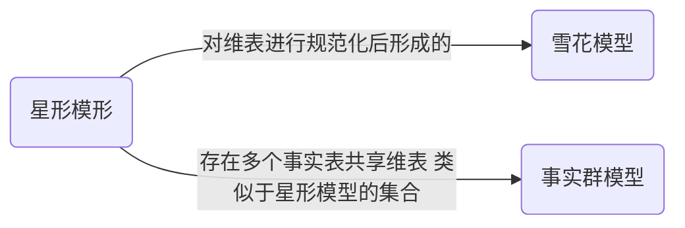

## 名词解释

- **元数据**
  - “关于数据的数据”，是指在数据仓库建设过程中产生的有关数据源定义、目标定义、转换规则等关键数据，是定义数据仓库对象的数据。如传统数据库中的数据字典就是一种元数据。

- **操作型处理** - 1   $\bigstar \bigstar\bigstar$
  - 也叫事务处理，是指对数据库联机的日常操作。响应时间，数据的安全性和完整性
- **分析型处理** - 1   $\bigstar \bigstar\bigstar$
  - 用于管理人员的决策分析，是指对数据的查询和分析操作
- **OLTP** - 1  
  - on-line transaction process 联机事务处理
- **OLAP** - 1
  - on-line analysis process 联机分析处理
  - *是使分析人员、管理人员或执行人员能够从多种角度对从原始数据转化出来的，能够真正为用户所理解 的，并真实反映企业多维特性的信息进行快速、一致、交互的存取，从而获得对数据更深入了解的一类软件技术*
- **数据仓库** - 1
  - 是为企业所有级别的决策制定过程，提供所有类型数据支持的战略集合。包括数据源，后台数据抽取、转换和加载工具，数据仓库服务器，OLAP服务器以及前台数据分析工具。
- **DSS** - 3
  - 决策支持系统（decision support system），需要具备 的基本功能是建立各种数学模型，对数据进行统计分析，得出有用的信息作为决策的依据和基础。
- **主题** - 7    $\bigstar \bigstar \bigstar$
  - subject，是在较高层次上将企业信息系统中的数据综合、归类并进行分析利用的抽象。
- **面向主题** - 7 $\bigstar \bigstar \bigstar$
  - subject-oriented，就是在较高层次上对分析对象的数据的完整、一致的描述。
- **主题之间的重叠** - 10
  - ~是逻辑性重叠，而不是同一个数据内容的重复物理存储
  - ~是细节级重叠，因为在不同的主题中的综合方式是不同的
  - ~并不一定是两两重叠
- **主题域** - 11
  - 面向主题的数据组织方式是根据分析要求将数据组织成一个完备的分析领域
- **ETL工具** -14
  - 是包括数据抽取（extracting）、清洗（cleaning）、转换（transformation）、加载（load）、维护（maintain）工具等集成工具
- **数据抽取** - 15
  - 从数据源中选择数据仓库需要的数据
- **数据清洗** -15
  - 为保证数据的质量，对抽取得到的数据要进行清洗
- **数据转换** -15
  - 将清洗后的数据按照数据仓库的主题进行组织
- **数据加载 -15**
  - 将数据装入数据仓库中
- **数据仓库服务器** -15
  - data warehouse server，负责管理数据仓库中的数据，储存企业级的数据，为整个企业的数据分析提供一个完整、统一的视图，一般要关系数据库管理系统扩展而成。
- **ROLAP** -15
  - 采用关系数据库管理系统或扩展的关系数据库管理系统来存储和管理数据。数据以关系表的形式存储在数据仓库中。
- **MOLAP** -15
  - 采用多维数组来存储数据的OLAP。直接定位、计算速度快、不需要索引，数据稀疏，需要进行压缩
- **HOLAP** -15
  - 以ROLAP结构和MOLPA结构结合起来的OLAP叫做混合型OLAP
- **特殊**SQL服务器 -16
  - 为只读环境下在星形模型或雪片模型基础上进行SQL查询提供支持的服务器
- **数据仓库的前台工具** -16
  - 主要包括各种数据分析工具。
- **数据仓库的后台工具** -16
  - ETL工具等集成工具
- **数据集市** -16
  - 小型数据仓库，面向部门级的应用，也称为部门级数据仓库
- **操作型数据存储** - 22
  - operational data sotre，ODS，是用于支持企业日常全局应用的数据集合。OSD满足企业级全局应用大致划分为两类：一类是企业级OLTP，一类是即时OLAP。
- **企业级OLTP** - 23
  - 是指在实际数据处理中一个事务同时涉及多个部门的数据。
  - 全局OLTP
  - 全局联机事务处理
- **即时OLAP** - 23
  - 主要参考和存取当前或接近当前的数据，并且要求有较快的响应速度，这类对数据的即时分析处理称为即时OLAP。
  - 实时联机分析处理
- **多层ODS** - 26
  - 子公司的OSD进行子公司的全部事务处理，并作为与总部进行数据联系的接口，集成各子公司的OSD数据，形成总总ODS。
- **EIS** - 30
  - 经理信息系统 excecutive information system，不仅要获得长期决策信息，也要进行日常决策。
- **粒度** -32  $\bigstar \bigstar \bigstar$
  - 数据粒度，是数据仓库的重要概念。可分两种形式
    - 1、粒度是对数据仓库中数据的综合程度高低的一个度量
    - 2、粒度是样本数据库，而是根据采样率的高低来划分的
- **分割** - 33  $\bigstar \bigstar \bigstar$
  - 是指将数据分布到各自的物理单元中，以便能分别独立处理，提高数据分析效率
- **数据分片** - 33
  - 数据分割后的数据单元称为分片
  - 水平分片
  - 垂直分片
  - 导出分片
  - 混合分片
- **多维数据模型** - 44
  - 多维数据模型主要研究多维数据的抽象表示问题。*多维数据模型是一个多维空间，维表示用户观察对象，多维空间中的点表示度量的值。*
- **维**  - 44
  - dimension，维是人们观察数据的特定角度，是某个事物的属性。例：时间维、地区维、产品维等。
- **维成员** - 45
  - member，维由一些维成员构成。维的一个取值称为维的一个成员。
- **维层** - 46
  - level，人位观察数据时除了要从某一个角度去观察外，还需要从不同的细节程度去观察，我们称这些不同的细节程度为不同的维层。例对于时间维，日、月、季、年是不同的细节
- **维层次** - 46
  - hierarchy，维层实际上是一种分类方法。在一个维中可以有多种分类方法，每种分类方法叫做一个层次。例：时间维，除可以按年、季度、月、日分层外，还可以按年、星期、日分层，所以有两个层次。
- **维属性** - 47
  - attribute，维属性说明维成员所具有的特征。
- **度量** - 47
  - measure，度量是要分析的目标或对象。
- **输入度量** - 47
  - 输入度量的值从业务处理活动中获取，例：销售量
- **导出度量**
  - 导出度量需要经过计算得到，例：利润
- **可累计型度量** - 47
  - 能沿时间维做聚集运算的度量
- **不可累计型度量** - 47
  - 不能沿时间维做聚集运算的度量，例：库存量
- **数据方体** - 47
  - 多维数据模型构成的多维数据空间称作数据方体（data cube，简称cube），也称数据立体体、超方体、多维超方体等
- **数据单元** - 49
  - 数据方体以维为数轴。在一个数据方体中，当每个维上都确定了一个维成员时，就会唯一地确定多维空间中的一个点，这个点就称作业数据单元。
- **星形模型** - 49
  - 通常由一个很大的中心表和一组较小的表组成，是多维数据模型的基本结构。
- **事实表** - 49
  - 星形模型大的中心表通常称为事实表（fact），用来存储事实的度量值及各个维的码值。
- **维表** - 49
  - 与事实表相连接的周围那组小的表通常称为维表。用来保存维的信息，即每个维成员的信息，包括维的属性信息和维的层次信息等。
- **雪片模型** - 50
  - 也称雪花模型，雪片模型对维表进行规范化后形成的，这样的维表易于维护且节省存储空间。
- **事实群模型** - 51
  - 在某些复杂的应用中可能需要多个事实表来共享维表， 这种模型类似于星形模型的集合，称为星系模型或事实群模型。
- **聚集** - 52
  - 聚集是对细节数据进行综合的过程，是多维分析的基础。聚集函数有 sum, count, min, max, average, median, rank
- **分布型聚集函数** - 52
  - distributive，将数据分成$n$份，对其中的每一份应用该函数，可以得到$n$个聚集值，再对这$n$个聚集值进行计算得到的结果如果和整个数据不划分应用该函数得出的结果一致，则说该函数是分布型的。便如count, sum, min, max等。分布型聚集函数具有可以累计的特性。
- **代数型聚集函数** - 52
  - algebraic，如果一个聚集函数可以由若干个分布函数进行代数运算得出，则说该函数是代数型的。例如avg=sum/count, max_N, standard deviation。
- **整体型聚集函数** - 52
  - holistic，如果一个聚集数不能由其他函数进行代数运算得出，则说该函数是整体型的。例如median, rank。消耗较多的资源，较大的计算代价。
- **多维分析操作** - 53
  - 是指对数据方体执行切片、切块、旋转等各种分析操作，剖析数据，使用户能从多个角度、多个侧面观察数据库中的数据，从面深入了解包含在数据中的信息和内涵。
- **切片** - 53
  - slice，在数据方体的某一维上选定一个维成员的动作称为切片。

- **切块** - 53
  - dice，在数据方体的的某一维上选定某一区间的维成员的动作称为切块。


- **旋转** - 54
  - rotate，改变数据方体维的次序的动作称为旋转。旋转操作并不对数据进行任何改变，只是改变观察数据的角度。
- **下钻操作**（drill-down） - 55
  - 在某个分析的过程中，可能需要从更多的维或者某个维的更细层次上来观察数据，这时可以通过下钻操作来进行更深入的分析。
  - 下钻操作分为两种类型
    - 一种是在现在的维上钻取到更细一层的数据
    - 另一种是增加更多的维来钻取数据
- **上卷操作**(roll-up) - 55
  - 上卷操作是与下钻操作相反的操作类型，是为了看到更粗的数据。
  - 上卷操作的两种类型
    - 一种是上卷到现有的某个维的更高层次去进行分析
    - 另一种是减少一个维来进行分析
- **星型连接** - 73
  - ROLAP以关系数据库的表的形式存放维表和事实事，极端的情况下，每个维表需要同时和事实表做连接操作，这种连接称为星形连接。
- **数据方体预计算** - 76
  - 数据综合是一件非常低价夫人操作，为了缩短查询响应时间，一个比较好的方法是根据统计分析用户的查询习惯，对常用的cuboid预先计算并存储，以减少实时计算时间。
- **数据方体缩减** - 87
  - 该技术采用一种特殊的数据压缩手段将整个数据文体存储下来，从而为高效查询处理提供了支持，该技术称为数据文体缩减技术。Dwarf，Condensed, Quotient
- **数据方体维护** - 105
  - 当数据源中的数据发生变化后，需要将这些变化反映到数据文体中。如果数据文体中的部分视图进行了实体化，则需要对这些实体化视图进行维护。如果数据文体存储时采用了某种上数据缩减结构，则需要将变化反映到这些缩减结构中。
  - 两种维护方法
    - 重新计算
    - 增量维护

## 简答题

- **请简要说明事务处理环境不适宜DSS应用的原因**。- 3   $\bigstar \bigstar\bigstar$
  
  1. 事务处理和分析处理的性能特性不同
  2. 数据集成问题
  3. 数据动态集成问题
  4. 历史数据问题
  5. 数据综合问题
  
- **为什么说在传统的数据库环境中直接构建分析型应用是一种失败的尝试？**- 5
  
  - 1、数据的分散问题
  - 2、“蜘蛛网"问题
  - 3、数据不一致问题
  - 4、数据的动态集成问题
  - 5、历史数据问题
  - 6、数据的综合问题
  
- **操作型环境在处理分析型应用时具有的局限性是什么？**- 5

  - 同上

- **传统的数据库环境在处理分析型应用时所面临的局限性是什么**？- 5

  - 同上

- **操作型数据和分析型数据的主要区别是什么？**- 4    $\bigstar \bigstar \bigstar$

  - | 操作型数据                            | 分析型数据                 |
    | ------------------------------------- | -------------------------- |
    | 细节的                                | 综合的或提炼的             |
    | 当前数据                              | 历史数据                   |
    | 可更新                                | 不可更新                   |
    | 操作需求事先可知道                    | 操作需要求事行不知道       |
    | 生命周期符合 软件开发生命周期（SDLC） | 完全不同的生命周期         |
    | 一个时刻操作一个单元                  | 一个时刻操作一个集合       |
    | 事务驱动                              | 分析驱动                   |
    | 面向业务处理                          | 面向分析挖掘               |
    | 一次操作数据量小，计算简单            | 一次操作数据量大，计算复杂 |
    | 支持日常操作                          | 支持管理需求               |

    

- **操作性处理和分析型处理的主要区别是什么？**- 4

  - 操作型处理主要用于企业的日常事务处理工作，数据库中存放的是细节数据。
  - 分析型处理主要用于企业的管理工作，数据库一般存放的是历史数据和综合数据。

- **请举例说明什么是操作型处理？**- 4

  - 零售店的数据库中存放着每个商品每次销售的情况，包括日期、时间、商品名称、单价、销售数量，有的还包括购买者。

- **请举例说明什么是分析型处理？**- 4

  - 零售店的数据库中存放了多年来积累的每种商品每天的销售情况，还存放了综合数据，例如存放每个月每种商品的销售问题等。

- **什么是数据仓库？**- 7  $\bigstar \bigstar \bigstar$

  - 书上来的
  - 数据仓库是作为**决策支持系统**服务基础的分析型数据库，用来存放大容量的**只读数据**，为制定决策提供所需的信息
    - 数据仓库是与操作型系统**相分离的**、基于标准企业模型集成的、**带有时间属性的**、**面向主题**及**不可更新**的**数据集合**。
  - 课件上
    - 数据仓库就是一个用以更好地支持企业或组织的决策分析处理的、**面向主题的**、**集成的**、**不可更新的**、**随时间不断变化**的数据集合

- **请给出一种数据仓库的定义**。- 7

  - 同上

- **数据仓库的四个基本特征是什么？**- 7    $\bigstar \bigstar \bigstar$

  - 数据是**面向主题**的
  - 数据是**集成**的
  - 数据是**不可更新**的
  - 数据是**随时间不断变化**的

- **什么是主题与面向主题？** - 7   $\bigstar \bigstar \bigstar$

  - 主题是一个抽象的根据，是较高层次上次企业信息系统中的数据综合、归类并进行分析利用的抽象。
  - 面向主题的数据组织方式，就是在较高层次上对分析对象的数据的完整、一致的描述。它能完整、统一地刻画各分析对象所涉及企业的各项数据，以及数据之间的联系。

- **什么是主题域？**- 11

  - 面向主题的数据组织方式是根据分析要求将数据组织成一个完备的分析领域，称为主题域。

- **你是如何理解数据仓库的数据是不可更新的，数据仓库的数据又是随时间不断变化的？**  $\bigstar \bigstar \bigstar$

  - 数据仓库的数据不可更新是针对具体的数据应用来说的，数据仓库的用户在进行分析处理是一般**不进行数据更新操作**，并不代表数据集成加载进行数据仓库到最终被删除的整个数据生存周期中，数据仓库中所有的数据都是永远不变的。从宏观的角度来看，数据仓库的数据是随时间的变化不断变化 的。
    - 随时间变化不断增加新的数据
    - 将不需要的数据卸出，转存到其他存储设备
    - 包含有大量的综合数据，这些数据中很多与时间有关

- **为什么说数据仓库是不可更新的又是随时间不断变化的？**- 11

  - 同上


- **请举例说明多维分析操作“切片“的含义是什么。**- 53
- slice，在数据方体的某一维上选定一个维成员的动作称为切片。它的含义即在多维数据中选定一个维
  - 例：一个按产品维、地区维和时间维组织起来的产品销售数据，用多维数组表示，如果在时间维上选定一个维成员，就得到了在时间维上的一个切片。
- **请举例说明多维分析操作“切块“的含义是什么。**- 53
- 将时间维上的取值设定为一个区间，如 2009年1月到2009年12月 就得到一个数据切块，可以看到是由2009年1月到2009年12月的12个切片叠合而成。
- **请举例说明多维分析操作“旋转“的含义是什么。**- 54
- 例如：把一个横向时为时间，纵向为产品的报表旋转成为横向产品、纵向为时间的报表。旋转操作是一个列换到行的操作，即把时间从列换到行来进行分析。
- **请举例说明多维分析操作“上卷“（rull-up）的含义是什么。**- 55
- 例如：有2019 ~ 2021年的数据，在完成由月到季度的分析后，如果要分析这3年来数据的变化趋势，就可以通过一个上卷的操作将数据汇总到时间给的”年“这一层。与下钻操作是相反的操作类型。
- **请举例说明多维分析操作“下钻“（drill-down）的含义是什么。**- 55
- 例如：在分析时发现2020年第3季度的数据有异常情况，因此先通过切片操作切灵2020年第3季度的数据进行详细分析；如果还不能发现问题，就需要看第3季度每个月的情况；如果发现异常情况是因8月份的数据引起的，则再对8月份的数据进行钻取，钻到时间维最低的层次“日”，就可以有更详细的数据来支持分析。此时采用的方法为下钻操作，钻取到时间维上更低（更细）的层次。
- **请举例说明什么是分布型聚集函数。**- 52
- 例如：count, sum，min，max，都是分布型聚集函数。分布型聚集函数具有可以累计的特性。可以分成n份，分别进行计算得到n个聚集值 ，再对这n个聚集值进行计算到结果。
- **请举例说明什么是代数型聚集函数。**- 52
- 例如：average可以通过 sum / count，而其中的sum和count都是分布型函数。可以由若干个分布型函数进行代数运算得出的叫代数聚集函数。
- **请举例说明什么是整体型聚集函数。**- 53
- 例如：median，rank等，这类函数在计算时要同时用到所有的数据，不能由其他函数进行代数运行得出。
- **整体型聚集函数有什么特点？**- 53
- 需要用到所有的数据进行计算，需要消耗较多的资源，具有较大的计算代价。
- **分布型聚集函数有什么特点？**- 52
- 具有可累加性
- **代数型聚集函数有什么特点？**- 52
- 可以转化为分布型函数
- **常用的聚集函数有哪三种类型？**- 52
- 分布型聚集函数，代数型聚集函数，整体型聚集函数
- **常用的多维分析操作有哪些？**- 53
- 切片，切块，旋转等分析操作
- **请举出两种常用的多维分析操作的例子。**- 53
- **切片**
  - 一个按产品维、地区维、和时间维组织起来的产品销售数据，用多维数组表示为（地区，时间，产品；销售额）如果在时间维上选定一个维成员（例：2019年1月），就得到了在时间维上的一个切片。
  - 切块
  
  - 一个按产品维、地区维、和时间维组织起来的产品销售数据，用多维数组表示为（地区，时间，产品；销售额）如果在时间维上的聚会设定为一个区间（例：2019年1月到2019年10月），就得到了一个数据切块。
- **请举出两种常用的聚集函数的例子。**- 52
- **分布（distributive）型聚集函数**
  - count, sum, min, max
  - 代数（algebraic）型聚集函数
  
  - average, min_N, max_N, standard_deviation
  - 整体（holistic）型聚集函数
  
  - median, rank等


1. **MOLAP存储有什么优缺点？**- 68
   - multi-dimensional OLAP (MOLAP)，使用多维数组存储数据方体
   - 优点：
     - 多维数组表达清晰，占用的存储空间少
     - 多维数组查找速度快，维护代价小
     - 多维数组有利于多维计算
     - 多维数组有利于预综合
   - 缺点：
     - 数据稀疏问题
2. **多维数据如果采用多维数组存储方式有什么优缺点？**
   - 优点：
      - 多维数组表达清晰，占用的存储空间少；多维数组查找速度快，维护代价小；多维数组有利于多维计算；多维数组有利于预综合
   - 缺点：
      - 多维数组存储方式的最大缺点就是数据稀疏问题
3. **ROLAP存储有什么优缺点？**
   - 优点：
      - 采用关系表存储数据，可以有效的处理海量数据，
   - 缺点：
      - 但是对多维数据的处理涉及到大量昂贵的连接运算，查询速度较慢，必须采用预计算和索引等技术加以克服
4. **多维数据如果采用关系表存储有什么优缺点？**
   - 同上
5. **什么是粒度？** - 31  $\bigstar \bigstar \bigstar$
   - 数据仓库中的数据存在着不同的综合级别，一般称为粒度。
   - 粒度越大表示细节程度越低、综合程度越高
   - 数据粒度，是数据仓库的重要概念。可分两种形式
     - 1、粒度是对数据仓库中数据的综合程度高低的一个度量
     - 2、粒度是样本数据库，而是根据采样率的高低来划分的
6. **数据仓库中存在这哪两种形式的粒度？** - 32  $\bigstar \bigstar \bigstar$
   1. 第一种粒度是对数据仓库中数据的综合程度高低的一个度量。它即影响数据仓库中数据量的多少，也影响数据仓库所能回答询问的种类
   2. 第二种粒度是样本数据库。样本数据库的粒度级别不是根据综合程度的不同来划分，而是根据采样率的高低来划分的。
7. **数据粒度与数据综合程度之间的关系是什么？** - 32
   - 粒度越小，细节程度越高，综合程度越低。
8. **什么是多重粒度？** - 32
9. **数据分割有哪几种形式？** - 33  $\bigstar \bigstar \bigstar$
   - 数据分割是指将数据分布到各自的物理单元中，以便能分别 独立处理，提高数据分析效率。数据分割后的数据单元称为分片。
   - 形式：水平分割，垂直分割，*混合分割*，
10. **数据仓库中数据的分割是指什么？**- 33
   - 数据分割是指将数据分布到各自的物理单元中，以便能分别 独立处理，提高数据分析效率。数据分割后的数据单元称为分片。
11. **什么是数据分片？数据分片有哪些类型？**- 33
    - 数据分割后的数据单元称为分片
    - 水平分片、垂直分片、导出分片、混合分片
12. **请给出一个数据水平分片的例子。**
    - 按时间分
13. **请给出一个数据垂直分片的例子。**
    - 按业务领域
14. **数据仓库的数据组织形式**   $\bigstar \bigstar \bigstar$
    - 简单堆积文件
       1. 它将数据库中提取并加工的数据逐一积累存储
    - 轮转综合文件
       - 数据存储单位被分为若干个级别
       - 轮转记录—综合
    - 简化直接文件
       - 间隔一定时间的数据库快照，类似简单堆积文件
    - 连续文件
       - 两个连续的简化直接文件 —> 比较他们的不同 –> 连续文件
       - 连续文件 + 新的简单文件 –> 新的连续文件

 

1． **数据集市与数据仓库的区别是什么？**- 19

- 数据集市是部门级的数据仓库，和全局数据仓库之间有许多不同
  - 数据集市是为特定部门的主题域而组织起来的一批数据和业务规则 。不同部门有不同的主题域，因在弛就有不同的数据集市。
  - 构成数据集市的软硬件、数据和应用程度都隶属于不同的部门

**2． OLAP的主要特点是什么？**- 43

1. 快速性
   - 用户对OLAP的快速反应能力有很高的要求，系统应能在很短的时间内对用户的大部分分析要求做出反应
2. 可分析性
   - OLAP系统应能处理与应用有关的各种逻辑分析和统计分析
3. 多维性
   - 系统必须提供对数据的多维视图和分析，包括对维层次和多重维层次的完全支持。
4. 及时性
   - 不论数据量有多大，也不管数据存储在何处，OLAP系统应能及时获得信息，并且管理少量信息

**3． 多维数据模型的核心概念有哪些？** - 45

- 多维数据模型的核心概念，包括维（dimension）、度量（measure）、数据方体（cube）、数据单元（cell）等

**4． 三种常用的多维数据模型是什么？**- 44

- 星形模型，雪花模型，事实群模型

**5． 三种常用的多维数据模型之间有什么区别与联系？** - 49

- 星形模型是多维数据模型的基本结构，通常由一个很大的中心表和一组较小的表组成。大的中心表称为事实（fact）表，用来存在事实的度量值。与事实表相连接的周围寻些小的表通常称为维表。

  ```mermaid
  graph LR
  A("时间 维表")  -.->  G("事实表")
  B("销量商 维表") -.->  G("事实表")
  C("产品 维表")  -.->  G("事实表")
  D("地区 维表")  -.->  G("事实表")
  ```

  



**6． 常用的多维数据模型“星型模型“有什么优缺点？** - 49

- 优点
  - 星形模型是多维数据模型的基本结构，通常由一个很大的中心表和一组较小的表组成。大的中心表称为事实（fact）表，用来存在事实的度量值。与事实表相连接的周围寻些小的表通常称为维表。维表用来保存维的信息，即每个维成员的信息，包括维的属性信息和维的层次信息等。简单，易维护，性能好
- 缺点：
  - 星形模型不支持维的层结构。每个维只有一个维表，实现时将所有的维层属性存放在这个表中，没有进行规范化。因为要表示 所有的层，每个层有自己的属性，所以有很多冗余。

**7． 常用的多维数据模型“雪花模型“有什么优缺点？** - 50

- 优点
  - 雪花模型中的维表是规范化，这样的维表易于维护且节省存储空间。更好的体现了维的层结构，对于数据库建模和设计人员来说，它非常易于理解 和进行维分析。
- 缺点
  - 雪花模型在执行查询时需要进行较多的连接操作，可能 影响系统 的性能。

**8． 星形模型的缺点是什么？如何对其进行改进？** - 49

- 星形模型不支持维的层结构。每个维只有一个维表，实现时将所有的维层属性存放在这个表中，没有进行规范化。因为要表示 所有的层，每个层有自己的属性，所以有很多冗余。
- 对星形模型的维表进行规范化

**9． 雪片模型的缺点是什么？如何对其进行改进？** - 51

- 雪花模型对维表进行规范化后形的，用多张表描述一个复杂维，执行查询时需要进行较多的连接操作，可能影响系统的性能。
- 解决方式是将星形模型和雪花模型结合起来使用。对大的维表进行规范化节省存储空间；对小的维表仍采用星形模型中的不规范形式，以避免由于多表连接引起的性能衰减。

**10． 数据仓库中常用的索引方法有哪些？** - 93

- 树索引
  - B树索引
  - R树索引
  - cube树索引
- 位图索引（bitmap）
  - 简单位图索引
  - 编码位图索引
  - projection索引
  - bit-sliced索引

**11． 什么是Projection索引？** - 99

- 将某个表的某一殚以相同的顺序冗余存储。这样做的好处是，查询是如果不需要则可以不读取其他列的值。

**12． R树索引和B树索引的主要区别是什么？** - 94

- R树和B树的最大区别在于，在R树中兄弟之间的矩形边框可以互相重叠。如果将R树用于点查询，则该点可能 会同时落到多个子女的矩形边框中。

**13． 举例说明简单位图索引（Bitmap Index）的创建过程。**- 98

**14． 举例说明简单位图（Bitmap Index）索引的使用过程。** - 98

**15． 简单位图索引（Bitmap Index）的主要优点有哪些？**- 99

- 较紧凑，节约空间。位图索引的大小与殚的不同值的个数成正比
- 可以使用有效的位操作来快速回答查询。使用位图索引可大大降低被扫描数据的数量 。查询快。

 

## 论述题

1． **在向数据仓库追加数据时，捕捉数据变化常用的途径有哪些？** - 33    $\bigstar \bigstar \bigstar$

- 数据追加：数据仓库的数据初装完成后，再向数据库输入数据的过程
- 追加内容：上次数据追加后再OLTP数据库中变化了的数据

1. 时标方法
  - 如果数据含时标，对新插入或更新的数据记录，在记录中加更新时的时标，则只需要根据时标即可判断 哪些数据 是上次追加后变化 了的。如果源数据并不包含时标，需要对源数据库的数据模型加以修改，加上时标字段。
2. DELTA文件
  - 它是由应用生成的文件，用来记录应用所改变的数据内容。利用DELTA文件来捕捉变化数据效率比较高。但是生成DELTA文件的应用并不普遍。
3. 前后快照文件的方法
  - 在上次抽取数据库数据 到数据仓库之后 及本次将抽取数据库数据之前，对数据库分别做一次快照，然后比较两幅快照的不同，从而确定实现数据仓库追加的数据。占用大量资源 ，可能 会较大的影响系统的性能。
4. 日志文件
  - 它是最可取的技术之一。因为日志文件是数据库的固有机制，因此 不会影响OLTP的性能。同时还有DELTA文件的优越性质，提取变化 数据只局限于日志文件，而不需要扫描整个数据库。

**2． 什么是数据集市？它有什么作用？** - 16，19

- 数据集市 是一种小型数据仓库，它通常有较少的主题域。数据集市面向部门级的应用，一般只能为某个部门的管理人员服务，因此也称为部门级数据仓库。
- 数据集市体现了分工协作 ，各负其责的管理理念，满足了企业和部门不同层次、不同范围的管理人员对数据的需求。
- 数据集市结构简单，管理也较容易。数据集市的思想同时体现了分布式数据库的思想。

**3． 什么是ODS? 为什么要引入ODS？** - 22

- 操作型数据存储（operational data store，ODS）是用于支持企业日常全局应用的数据集合。
- 在很多情况下，有些数据处理是操作型的，但不适合在操作型数据库中进行，而又存在着一些分析型数据处理，却不适合在数据仓库中进行。这种问题并不是联机事务处理，又算不上高层决策分析，导致了一种新的数据环境 -- 操作型数据存储（operational data store，OSD）的建立。
- OSD作为一个中间层次，一方面包含企业全局一致的、细节的、当前 或接近当前的数据，可以进行全局不是没人看问题型处理，另一方面OSD又是一种面向主题、集成的数据环境，且数据量较小，适合辅助企业完成日常决策的数据分析处理。

**4． ODS中的数据具有什么特点？** -23

- OSD 用于支持企业日常全局应用的数据集合。
  - OSD中数据具有4个基本特点：
    - 面向主题的：和数据仓库一样，OSD中的数据的组织方式是面向主题的
    - 集成的：OSD中的数据在企业级上应保持高度的一致性，所以必须对OSD的数据进行转换和集成
    - 可更新的：OSD中存放当前数据或接近当前的数据，而且可以进行联机修改，包括增、删、改等操作。
    - 数据是当前或接近当前的：所谓”当前“是指数据在存取时刻是最新的，而”接近当前“则是指存取的数据是最近一段时间之前得到的。

**5． ODS和DW的区别是什么？** - 27

1. 最大的差别是两者存在的数据内容不同

   - 

   | 操作型数据存储（ODS） | 数据仓库（DW）     |
   | --------------------- | ------------------ |
   | 当前或接近当前的数据  | 历史数据           |
   | 细节数据              | 细节数据和综合数据 |
   | 可联机更新            | 不可变快照         |

2. OSD与DW的数据量是不同等级的，尤其是DW中保存了大量的历史数据，其数据量要远远超出ODS。

3. 二者的技术支持不尽相同。OSD要支持面向记录的联机更新，又要随时保证其数据与源数据库系统中数据的一致性。因而需要的支持技术与面向应用的分散DB系统 的支持技术一样复杂。而DW中，则需要支持ETL技术和数据快速存储技术等

4. 二者面向的需求不同。OSD的需求有两方面：一是满足企业进行全部应用的需要，包括企业级OLTP和即时OLAP；二是向DW提供一致的数据环境以供抽取。DW则主要用于高层战略决策，如长期趋势分析、预测等

5. 二者的使用者不同。ODS的使用者主要是企业的中层管理人员，他们应用ODS进行企业日常管理和控制；DW的使用者则主要是DSS分析员或企业高级决策层。

**6． 在DB～ODS～DW三层体系结构中，存在着哪两级记录系统？** - 28

- OSD的记录系统 在各操作型数据库系统 中，而DW的记录系统 一般在OSD之中
- 

**7． 什么是分层ODS？为什么要引入分层ODS？**

- 同第3题

**8． 什么是“操作型”处理模式？什么是“信息型”处理模式？二者如何切换？** - 25

- 操作型处理模式则指含有更新操作的工作模式（排他型的）
- 信息型处理模式就是只有查询操作的工作模式（非排他型的）
- 考虑到这两者的差别，引进 “动态切换”的思想，在进行信息型处理时，可以设置到分析型环境，关闭事务管理、并发控制 等模块，使得在进行即时OLAP时获得较快的响应速度。在进行操作型处理时，打开这些模块，以保证事务的原子性、一致性、隔离性和持续性等。

**9． 什么是企业级联机事务处理？什么是实时联机分析处理？** - 24

- 企业级联机事务处理（OLTP），是指在实际数据处理中一个事务同时涉及多个部门的数据。
- 实时联机分析处理（OLAP），是在中层决策过程并不需要参考太多的历史数据，而主要参考和存取当前和接近当前 的数据，并且要求有较快的响应速度，这类对对数据的实时分析处理称为实时联机分析处理

**10． ODS的功能主要是什么？** - 23

- OSD主要是为了满足进行企业级全局应用的需求而产生的。
- 在OSD上可以实现企业级OLTP
- 在OSD上可以实现即时OLAP

**11． 存放在ODS中的数据与存放在数据仓库中的数据有什么区别？** - 27

- 

| 操作型数据存储（ODS） | 数据仓库（DW）     |
| --------------------- | ------------------ |
| 当前或接近当前的数据  | 历史数据           |
| 细节数据              | 细节数据和综合数据 |
| 可联机更新            | 不可变快照         |

**12． ODS的作用是什么？** - 28

- OSD在DB ~ OSD ~ DW体系结构 中的作用：OSD在这里充当了承上启下的角色 。一方面OSD是一个全局的“提纲挈领”者；另一方面ODS一致和完整的数据世界将DW和原有的DB隔离开来，使DW卸去数据集成、结构转换等一系统沉重负担 。

**13． 在向数据仓库追加数据时，如何捕捉变化了的数据？**

1. 时标方法
   - 如果数据含时标，对新插入或更新的数据记录，在记录中加更新时的时标，则只需要根据时标即可判断 哪些数据 是上次追加后变化 了的。如果源数据并不包含时标，需要对源数据库的数据模型加以修改，加上时标字段。
2. DELTA文件
   - 它是由应用生成的文件，用来记录应用所改变的数据内容。利用DELTA文件来捕捉变化数据效率比较高。但是生成DELTA文件的应用并不普遍。
3. 前后快照文件的方法
   - 在上次抽取数据库数据 到数据仓库之后 及本次将抽取数据库数据之前，对数据库分别做一次快照，然后比较两幅快照的不同，从而确定实现数据仓库追加的数据。占用大量资源 ，可能 会较大的影响系统的性能。
4. 日志文件
   - 它是最可取的技术之一。因为日志文件是数据库的固有机制，因此 不会影响OLTP的性能。同时还有DELTA文件的优越性质，提取变化 数据只局限于日志文件，而不需要扫描整个数据库。

**14． 试述在数据库和数据仓库之间引入ODS的必要性。** - 22

- 操作型数据存储（operational data store，ODS）是用于支持企业日常全局应用的数据集合。
- 在很多情况下，有些数据处理是操作型的，但不适合在操作型数据库中进行，而又存在着一些分析型数据处理，却不适合在数据仓库中进行。这种问题并不是联机事务处理，又算不上高层决策分析，导致了一种新的数据环境 -- 操作型数据存储（operational data store，OSD）的建立。
- OSD作为一个中间层次，一方面包含企业全局一致的、细节的、当前 或接近当前的数据，可以进行全局不是没人看问题型处理，另一方面OSD又是一种面向主题、集成的数据环境，且数据量较小，适合辅助企业完成日常决策的数据分析处理。

**15． 引入ODS主要用于处理哪两种类型的操作？** - 23

- 实现企业级OLTP
- 实现即时OLAP

 

1． **请简述数据仓库的体系结构。** - 14

- 数据仓库由数据源、集成工具、数据仓库与数据仓库服务器、联机分析处理（OLAP）服务器、元数据与元数据管理工具、数据集市和前端分析工具等组成
- 数据仓库系统的体系结构的分类（1）两层架构（2）独立型数据集市（3）依赖型数据集市和操作型数据存储（4）逻辑型数据集市和实时数据仓库


**2． 在将数据源的数据加载到数据仓库前需要完成哪些工作？** - 15

- ETL（extracting, cleaning, transformation, load)

1. 数据抽取：指从数据源中选择数据仓库所需要的数据。
2. 数据清洗：为了保证数据的质量，对抽取得到的数据要进行清洗。
3. 数据转换：将清洗后的数据按照数据仓库的主题进行组织
4. 数据加载：将数据装入数据仓库中
5. 还要负责建立元数据：元数据主要说明数据仓库中数据的来源、加工过程等。

**3． 数据仓库体系结构中的OLAP服务器有哪四种类型？** - 15

- ROLAP（relation）结构，采用关系数据库管理系统 或扩展的关系数据库管理系统 来存储和管理数据。
- MOLAP（multi-dimension）结构，采用多维数组来存储数据。
- HOLAP（hydrib）结构，将ROLAD与MOLAD结构结合起来，同时利用ROLAP结构可扩展性好和MOLAP结构计算速度快的优点。
- 特殊SQL服务器。

**4． 什么是ETL工具？其主要功能是什么？** - 15

- 参考第2题

**5． 试述数据仓库的设计中提高数据仓库性能的方法和技术?**

- 提高数据仓库效率的方法：1 合并表，2建立数据序列，3引入冗余，4进一步细分数据，5生成导出数据，6建立广义索引，7 粒度划分，8分割

**6． 请简要说明数据仓库设计的步骤。**

- 明确主题

- 概念模型设计 所要完成的工作：确定系统边界，确定主要的主题域及其内容

- 技术准备工作 包括：技术评估，技术环境准备，形成技术评估报告，软硬件配置方案，系统（软、硬件）总体设计方案

- 逻辑模型设计 所要完成的工作：分析主题域，确定当前要装载的主题，确定粒度层次划分，确定数据分割策略，关系模式定义

- 物理模型设计 所要完成的工作：确定数据的存储结构-RAID技术，确定索引策略-B树索引、位图索引等，确定数据存放位置-磁带、磁盘等，确定存储分配优化

- 数据仓库生成 所要完成的工作：通过专用的数据抽取工具或者通过自行编程实现数据抽取、转换和装载

- 数据仓库运行与维护 所要完成的工作：建立DSS应用，使用数据仓库理解需求，调整和完善系统，维护数据仓库。

**7． 数据仓库的设计方法与操作型环境中系统设计采用的系统生命周期法有什么不同？**

- 在操作型环境中使用的是传统的系统开发生命周期SDLC。SDLC常被称为瀑布式开发方法，因为其中的每一项活动都是确定的，并且只有一个活动结束后，下一个活动才会被触发。

- 数据仓库开发则以一种完全不同的开发生命周期进行，又是这种周期成为CLDS（与SDLC顺序相反）。传统的SDLC由需求驱动，而CLDS几乎刚好相反：由数据开始，得到数据后，将数据集成。然后，检验数据存在什么偏差。之后，针对数据写程序，分析程序的执行结果，最后系统需求才得到理解。一旦系统需求得到理解，就需要对系统的设计进行调整，然后针对不同的数据集开始新的开发周期。因为开发生命周期不断的重新安排不同类型的数据，所以，CLDS常称作螺旋式开发方法。

- CLDS是传统的数据驱动开发生命周期，而SDLC是传统的需求驱动开发生命周期。

**8． 数据仓库的设计中，存在着哪三级数据模型？**

- 概念模型；逻辑模型；物理模型

- 概念模型常用的表示方法：

  - E－Ｒ方法（实体－联系方法）  描述工具：Ｅ—Ｒ图

    - 长方形表示实体，数据仓库中表示主题，框内写上主题名

    - 椭圆形表示主题的属性 无向边把主题与其属性连接起来

    - 菱形表示主题之间的联系，菱形框内写上联系的名字

        无向边把菱形分别与有关的主题连接

        无向边旁标上联系的类型

        若联系也有属性 用无向边连接属性和菱形

- 在RDBMS中:  关系模型
  - 主题以及主题之间的联系都用关系来表示
  - 关系模型的基本概念:
    - 关系　一个二维表；
    - 元组　表中的一行称为一个元组；
    - 属性　表中的一列称为属性,  给每一列起一个名称即属性名
    - 主码　表中的某个属性组, 它们的值唯一地标识一个元组
    - 域　　属性的取值范围
    - 分量　元组中的一个属性组
    - 关系模式　对关系的描述
    - 关系名（属性名1，属性名2，…，属性名n）

- 数据仓库的物理模型: 是逻辑模型在数据仓库中的实现，如：
  - 物理存取方式
  - 数据存储结构
  - 数据存放位置
  - 存储分配等等

**9． 数据仓库的设计中提高数据仓库性能的方法和技术有哪些?**

**10． 企业的数据库体系化环境的四个层次是什么？它们之间的关系是什么？**    $\bigstar \bigstar \bigstar$

- 数据库的体系化环境，是一个企业或组织内部，由各面向应用的**OLTP数据库**及**各级面向主题的数据仓库**所组成的完整的数据环境。并在这个数据环境上建立 和进行一个企业或部门的从**联机事务处理到企业管理决策**的所有应用。
- 四层体系化环境：
  - 操作型环境：细节的操作型数据，服务于高性能事务处理
  - 全局级数据仓库：存放细节数据 、导出数据
  - 部门级局部仓库：一般存放导出数据
  - 个人级数据仓库：数据一般是暂时存放，用于启发式的分析


- 多层次体系化环境的优点：
  - 数据的抽取方向，保证了不会出现 “蜘蛛网”的情况
  - 四层体系化环境与企业实际的部门组织结构相对应

**11． 什么是数据方体格结构，什么是导出关系？**

- 数据方体格结构实际上是一个有向图，图中的每个结点表示一个cuboid，图中的每条边表示结点之间的导出关系。通常用一个二元组(L，≤)来表示，其中L表示格中所有的cuboid，≤表示cuboid间的导出关系。如果cuboid a是由cuboid b通过减少维的个数或者上升维的层得到的，则称cuboid a可以由cuboid b导出。

**12． 什么是数据方体预计算？为什么要进行数据方体的预计算？**

- 在实际应用中，为了获得快速一致的响应，决策分析人员经常对一些数据进行预综合，存放在数据库中。例如，在关系表中加上一行总和的记录

**13． 什么是数据方体的缩减？为什么要进行数据方体的缩减？**

- 一类新的有效的数据方体存储结构--按照数据方体中数据所代表的不同的语义(或模式)信息将数据进行划分后压缩存储。
- Drawf: 利用数据的前缀和后缀语义信息将数据方体进行压缩

- Condensed: 利用单元组语义信息对数据方体进行压缩

- Quotient: 利用聚集值相等且连通的语义信息对数据方体进行压缩。

**14． 什么是数据方体的维护？为什么要进行数据方体的维护？**

- 当数据源的数据发生变化时，需要对数据方体（采用各种压缩方法缩减后的数据方体）中的数据进行相应的维护。

- 重新计算：简单方法，计算量太大

- 增量维护：在已有的数据方体基础上进行调整。

- 采用了两种技术：Addset数据结构；Sliding Window技术

**15． 多维查询语言MDX与结构化查询语言SQL有什么异同？**

- MDX语言和SQL语言一样，语句具有SELECT、FROM和WHERE结构。

- 但MDX语言采用其他的关键字来查询数据方体，返回可以进一步加以分析的数据，并提供了可以对返回的数据进行操作的相应的函数。而且，MDX语言增强了用户自定义函数的功能，可以扩展或者定制用户某些特殊的商业需求。

 

## 计算题

1. 在下面的事务数据库中，关联规则 A$\Rightarrow$C 的置信度和支持度是什么？关联规则 C$\Rightarrow$A 的置信度和支持度又是什么？设 min_sup = 60%，min_conf=80%，频繁项集有哪些？ 

| 事务号 | 项目集  |
| ------ | ------- |
| 1      | A，B，C |
| 2      | A，C    |
| 3      | A，D    |
| 4      | B，E，F |

 **解：**

| 规则            | 支持度 | 置信度 |
| --------------- | ------ | ------ |
| A$\Rightarrow$C | 2/4    | 2/3    |
| C$\Rightarrow$A | 2/4    | 2/2    |

**频繁项集为 {A}**

min_sup = 60% x 4 = [2.4] = 3条

| $C_1$ |      |      | $L_1$ |      |      |
| ----- | ---- | ---- | ----- | ---- | ---- |
|       | {A}  | 3    |       | {A}  | 3    |
|       | {B}  | 2    |       |      |      |
|       | {C}  | 2    |       |      |      |
|       | {D}  | 1    |       |      |      |
|       | {E}  | 1    |       |      |      |
|       | {F}  | 1    |       |      |      |


reference:

- **频繁项集：**
  - 满足最小支持度（频度）s的项集称为**频繁项集**。
- **关联规则：**
  - 同时满足最小支持度（频度）s和是小置信度c的规则 称为**关联规则**
- **支持度：指项集X和Y在数据库D中同时出现的概率**。
  - $\text{sup} = \frac{符合集数量}{总样本数量}$
- **置信度：**指在项集X出现的情况下，项集Y在数据库D中同时出现的条件概率，即Pr(Y/X)=Pr(XUY)/Pr(X)。
  - (符合集数量／X样本数量)
  - $\text{Pr}(Y/X) = \frac{\text{Pr}(X \cup Y)}{\text{Pr}(X)}$
- **寻找频繁项集**


