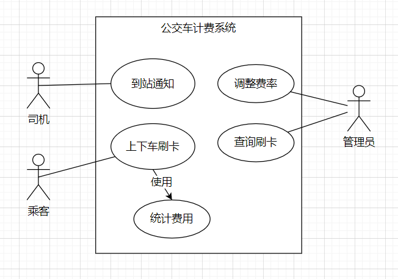
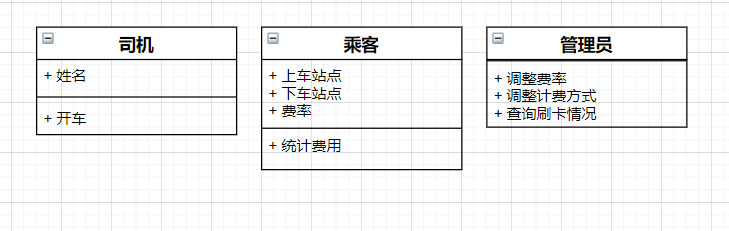

# 2020软件工程题库考试试题

## 填空题

1. **软件过程**
   - 软件过程是软件开发中一系列活动的集合

2. **统一过程RUP**
   - 统一过程 RUP，Rational Unified Process，统一过程是以用例驱动，以体系化结构为核心，迭代和增量的过程框架，是基于ULM的方法和工具的

3. **测试**
   - 软件进行审查或运行检查，以确保软件的符合需求。分为静态测试与动态测试

 

## 名词解释

1. **边界值分析**
   - 边界值分析是黑盒测试的一种方法。在等价类划分的基础上，针对输入数据或操作条件的边界值或极限值进行测试。

2. **决策过程**
   - 决策过程是从提出问题、确定目标开始，经过方案选优、作出决策、交付实施为止的全部过程

3. **项目整体管理**
   - 也叫集成管理，保证项目各个要素相互协调所需要的管理过程，它需要在相互影响的项目目标和方案中作出平衡，以满足或超出干系人的需求和愿望。

4. **预防性维护**
   - 是为了改进应用软件的可靠性和可维护性，为了适应未来的软硬件环境的变化，应主动增加预防性的新的功能，以使应用系统适应各类变化而不被淘汰

5. **类整体-部分结构图**
   - 如建立一个时钟类，这个类中的属性如秒、分钟、小时等，加上对属性的操作如秒记时，分钟记时，小时记时等，就是一个类的整体部分结构。 

## 简答题

1. **影响软件质量的因素有哪些**
   - 可直接度量的因素：如单时间内千行代码中所产生的错误数
   - 不可直接度量的因素：如可用性可维护性等
   - 软件质量因素集中在产生的三个重要方面：
     - 软件的操作特性
     - 软件承受变化的能力
     - 对新环境的适应性

2. **如何衡量软件的成本**
   - 功能点法：根据软件的功能复杂度和规模，计算软件的功能点数，再乘以每个功能点的成本，得到软件的总成本
   - COCOMO法：根据软件的类型、规模、开发难度等因素，使用数学模型估算软件的成本
   - 专家判断法：根据专家的经验和知识，对软件的开发过程和资源进行评估，得出软件的总成本
   - 类比法：根据与当前项目相似的历史项目的数据，对软件的开发过程和资源进行比较和调整，得到软件的成本。

3. **需求分析的任务是什么**
   - 需求获取
   - 需求分类
   - 需求筛选
   - 需求提炼
   - 需求优先级排序
   - 产生需求文档

4. **因果图的作用**
   - 因果图又称鱼骨图或石川图。它看上去有些像鱼骨。问题或缺陷标在鱼头外，在鱼骨上长出鱼刺，上面按出现机会多寡列出产生问题的可能原因。鱼骨图有助于说明各个原因之间如何相互影响。

5. **举例类整体--部分的关系**
   - 比如一个时钟类，有小时、分钟、秒等属性，还有计时等方法，这就是整体与部分的关系

 

## 论述题

- **软件工程的文档类型及其作用**
  - 软件工程的文档一般包括分为开发文档、维护文档
  - 开发文档，是提在软件开发过程中产生的文档，如果可行性研究报告，项目开发计划书，软件需求规格说明书，设计说明书，概要设计说明书，详细设计说明书，测试用例，测试计划，测试报告，用户手册等。它们主要用于描述软件系统的需求、设计、开发、测试、使用等方面的信息，以便于软件开发人员、管理人员、用户等进行沟通和协作。
  - 软件维护文档：是指在软件维护过程中产生的文档，如维护请求、维护方案、维护报告等。它们主要是用于记录软件系统的修改和更新的原因、方法、结果等信息，以便用于软件维护人员、管理人员、用户先进进行分析和评价。

 

## 应用题

**一个公交车计费系统，司机到站点击到站按钮，通知系统到站，乘客上车刷卡，下车刷卡，乘务员查询乘客是否刷卡，统计费用，管理员调整费率，计费方式**

1. **画用例图**

2. **画类图**

3. **画时序图**

