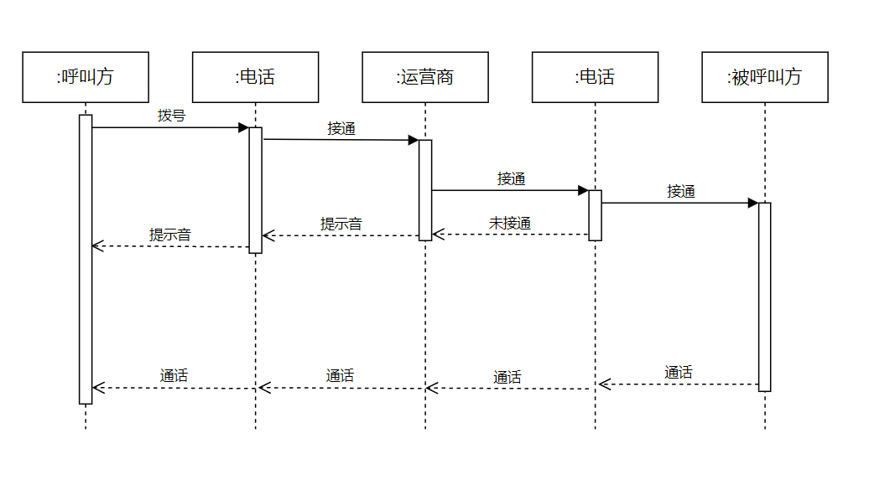
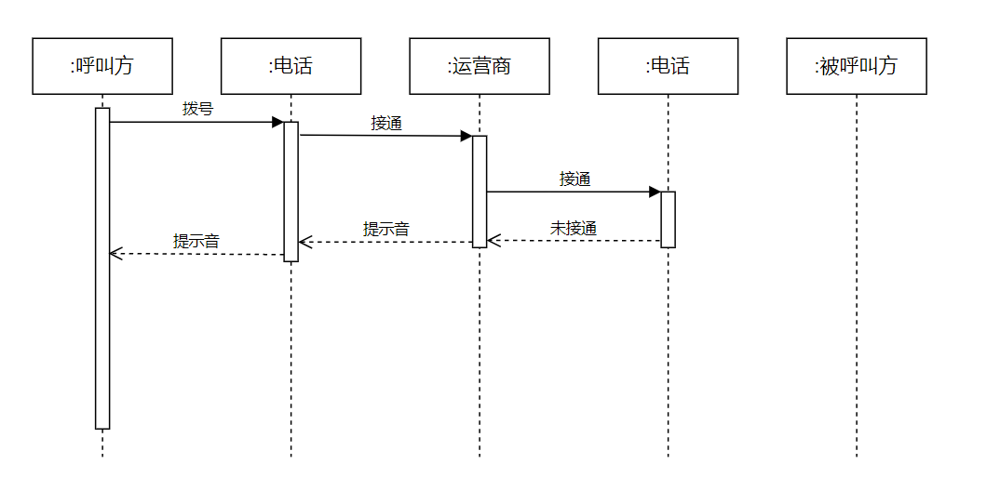

# 2023-10-19题库考真题

## 名词解释：（3×6=18）

- **软件可维护性**
  - 软件可维护性的定义：软件能够被理解、校正、适应及增强功能的容易程度。
- **需求评审**
  - 需求评审是软件开发过程中的重要环节。它的目的是确保需求文档的准确性、完整性和一致性，以及消除歧义。
- **控制耦合**
  - 一个模块A向另外一个模块B发送一个控制信息，B根据控制信息而作出相应的动作，称为控制耦合

## 简答：（4×8=32）

- **可行性研究的目的和作用**
  - 可行性研究的目的在于**研究解决问题的必要性和可能性**
  - 研究的内容：技术可行性；经济可行性；社会可行性包括；法律可行性
  - 作用：对于确保项目的顺利实施和投资回报有着至关重要的作用
- **软件生存周期作用**
  - 软件生存周期是指从软件需求提出到报废的整个过程，包括问题定义、可行性分析、总体描述、系统设计、编码、调试和测试、验收与运行、维护升级到废弃等阶段. 
  - 软件生存周期的作用在于规范软件开发过程，提高软件开发效率和质量，降低开发成本. 
    - 通过对软件生存周期的规范，可以使软件开发人员在开发过程中更加有条理，更加高效地完成各个阶段的工作，从而提高软件开发的质量和效率.
  
- **软件技术审查与管理评审**
  - 软件技术审查和管理审查是软件质量保证的两种重要活动。
  - **软件技术审查**是对软件开发过程中的各种文档、设计、代码等进行系统性、结构化的检查，以发现和消除潜在的缺陷，提高软件质量和可靠性。
  - **管理审查**是对软件项目的总体状况、成本、进度、风险等进行评估和监控，以便及时调整项目计划，保证项目目标的实现。
- **什么时候测试结束**
  - 通过在测试过程中进行风险、测试、覆盖率、缺陷和信心这5个方面的评估，并和测试计划中的要求进行比较，若能满足要求，就结束测试。
  - 在软件消亡之前，如果没有测试的结束点，那么软件测试就永无休止，永远不可能结束。软件测试的结束点，要依据自己公司具体情况来制定，不能一概而论！个人认为测试结束点由以下几个条件决定：
    - 基于“测试阶段”的原则 
    - 基于“测试用例”的原则
    - 基于“缺陷收敛趋势”的原则
    - 基于“缺陷修复率”的原则
    - 基于“验收测试”的原则
    - 基于“覆盖率”的原则
    - 基于“项目计划”的原则
    - 基于“缺陷度量”的原则
    - 基于“质量成本”的原则
    - 基于“测试行业经验”的原则

### 论述：（15）

- **软件过程、方法和工具在实践中的关系**
  - 软件过程、方法和工具是软件工程的三个核心要素。其中，**软件过程**是指在软件开发的整个生命周期中，按照一定的规范和流程进行的一系列活动，包括需求分析、设计、编码、测试、维护等。**软件方法**是指在软件开发过程中，采用的一种或多种技术和方法论，如面向对象、结构化分析与设计等。**软件方法**是为软件开发提供了“如何做”的技术。而**软件工具**则是指在软件开发过程中使用的各种辅助工具。**软件过程**将各个技术层次结合在一起，这三者之间相互依存，相互作用，共同构成了软件工程的核心体系，使得合理及时地开发计算机软件成为可能。

## 计算：（35）

- A和B打电话-时序图（顺序图）
  ①打通电话
  ②未打通电话
  
  

