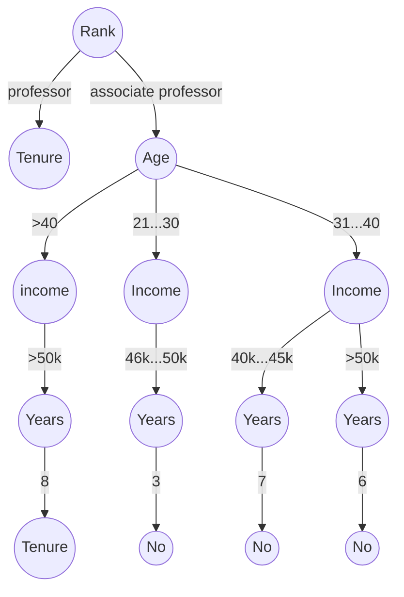

**一、现有如下事务数据库，设min sup=60%， min conf=80%**

**a) 请用Apriori算法找出所有的频繁项目集（10分）**

**b) 请画出FP-Growth方法进行频繁项集挖掘时用到的FP-Tree（10分）**

**c) 写出所有由包含M的频繁项目集所生成的关联规则（10分）**

| TID  | Items bought       |
| ---- | ------------------ |
| T100 | {M, O, N, K, E, Y} |
| T200 | {D, O, N, K, E, Y} |
| T300 | {M, A, K, E}       |
| T400 | {M, U, C, K, Y}    |
| T500 | {C, O, O, K, I, E} |

**答：**

a 与 c 请参考2018年7月[2018年7月真题.md]

 

**二. 假设数据挖掘的任务是将如下的8个点（用(x, y)代表位置）聚类为三个类。**

**A1(1, 7), A2(3, 7), A3(8, 4), B1(5, 8), B2(3, 5), C1(8, 2), C2(3, 9), C3(4, 8) 距离函数是曼哈顿函数。假设初始我们选择A1, B1和C1为每个聚类的中心，请用 k-means 算法给出在第一次循环执行后的三个聚类中心和聚类结果（中心的坐标值如是小数可向上取整）（25分）**

**答：**

第1次迭代：

| centroid | A1(1, 7) | A2(3, 7) | A3(8,4) | B1(5,8) | B2(3, 5) | C1(8, 2) | C2(3, 9) | C3(4, 8) |
| -------- | -------- | -------- | ------- | ------- | -------- | -------- | -------- | -------- |
| A1(1, 7) | **0**    | **2**    | 10      | 5       | **4**    | 12       | 4        | 4        |
| B1(5, 8) | 5        | 3        | 7       | **0**   | 5        | 9        | **3**    | **1**    |
| C1(8, 2) | 12       | 10       | **2**   | 8       | 8        | **0**    | 12       | 10       |

第1次迭代后的三个聚类与更新的聚类中心为：

| 聚类                          | 聚类中心 |
| ----------------------------- | -------- |
| A1(2, 10), A2(3, 7), B2(3, 5) | (3, 8)   |
| B1(5,8), C2(3, 9), C3(4, 8)   | (4, 9)   |
| A3(8, 4), C1(8, 2)            | (8,  3)  |

 

**三.** **在下面的教师数据表中，数据已经被离散化，如“21. . .30”代表年龄在21到30之间的人。Count表示该行在数据集重复出现的次数。假设Tenure是类标签属性，给定新元组“>40，46k. . .50k，Professor，6”， 请问如果用朴素贝叶斯分类法的话，该元组的类标签应该是什么？请写出计算步骤（25分）**

| Age     | Income    | Rank                | Years | Count | Tenure |
| ------- | --------- | ------------------- | ----- | ----- | ------ |
| 21...30 | >50k      | Professor           | 6     | 4     | Yes    |
| 31...40 | 40k...45k | Associate Professor | 7     | 10    | No     |
| <20     | 40k...45k | Professor           | 9     | 12    | Yes    |
| 31...40 | >50k      | Associate Professor | 6     | 3     | No     |
| >40     | >50k      | Associate Professor | 8     | 3     | Yes    |
| 21...30 | 46k...50k | Associate Professor | 3     | 4     | No     |
| >40     | <40k      | Professor           | 6     | 2     | Yes    |
| >40     | 46k...50k | Professor           | 5     | 5     | Yes    |

答：$C_1 = Yes, C_2 = No$

$P(C_i|X) = \dfrac{P(X|C_i) P(C_i)}{P(X)}$

$P(C_i|X) \propto P(X|C_i) P(C_i)$

所以有如下公式：

$P(Yes|X) \propto P(X|Yes) P(Yes)$

$P(No|X) \propto P(X|No) P(No)$

根据上表有：

$P(Yes) = \dfrac{26}{43}, \quad P(No) = \dfrac{17}{43}$

$P(>40|Yes)= \dfrac{10}{26}, \quad P(46k...50k|Yes)=\dfrac{5}{26}, \quad P(Professor|Yes)=\dfrac{23}{26}, \quad P(6|Yes)=\dfrac{6}{26}$

$P(>40|No)= \dfrac{0}{17}, \quad P(46k...50k|No)=\dfrac{4}{17}, \quad P(Professor|No)=\dfrac{0}{17}, \quad P(6|No)=\dfrac{3}{17}$

采用拉普拉斯修正

$\hat{P}(C) =\dfrac{|D_c| + 1}{|D| + N}, \quad \hat{P}(x_i |C) =\dfrac{|D_{cx_i}| + 1}{|D_c| + N_i}$

其中 $N$ 为训练集 $D$ 中可能的类别数，$N_i$ 表示第 $i$ 个属性可能的取值数

即有：

$\hat{P}(Yes) = \dfrac{26 + 1}{43 + 2}, \quad \hat{P}(No) = \dfrac{17 + 1}{43 + 2}$

$\hat{P}(>40|Yes)= \dfrac{10 + 1}{26 + 3}, \quad\hat{P}(46k...50k|Yes)=\dfrac{5 + 1}{26 + 4}, \\ \hat{P}(Professor|Yes)=\dfrac{23 + 1}{26 + 2}, \quad \hat{P}(6|Yes)=\dfrac{6 + 1}{26 + 4}$

$\hat{P}(>40|No)= \dfrac{1}{17+2}, \quad \hat{P}(46k...50k|No)=\dfrac{4+1}{17+3}, \\\hat{P}(Professor|No)=\dfrac{0+1}{17+1}, \quad \hat{P}(6|No)=\dfrac{3+1}{17+3}$
$$
\begin{aligned}
\hat{P}(Yes|X) &= \hat{P}(>40|Yes) \cdot \hat{P}(46k...50k|Yes) \cdot \hat{P}(Professor|Yes) \cdot \hat{P}(6|Yes)\\
&=\dfrac{11}{29}\cdot \dfrac{6}{30} \cdot \dfrac{24}{28}\cdot \dfrac{7}{30}\\
&=0.0152
\end{aligned}
$$

$$
\begin{aligned}
\hat{P}(No|X) &= \hat{P}(>40|No) \cdot \hat{P}(46k...50k|No) \cdot \hat{P}(Professor|No) \cdot \hat{P}(6|No)\\
&=\dfrac{1}{19}\cdot \dfrac{5}{20} \cdot \dfrac{1}{18}\cdot \dfrac{4}{20}\\
&=0.00014
\end{aligned}
$$

$\hat{P}(Yes|X) > \hat{P}(No|X)$ 故标签为 Tenure = Yes

 

**四. 假如训练集仍采用第三题中的教师数据库，再用决策树分类的过程中，假设已经决定赛用"Rank"作为树根，接下来将对原始训练数据集进行划分并进行迭代建树操作。请手工给出这一步数据集划分的结果，并描述后续建树的过程。（20分）**

答：$C_1 = Yes, C_2 = No$

由”Rank“ 作为树根，“Rank” 有两个类，分别是“Professor” 与 “associate Professor”，根据两类条件，可以把原来数据库划分为两个小的数据库。如下：

Rank = Professor

| Age     | Income    | Years | Count | Tenure |
| ------- | --------- | ----- | ----- | ------ |
| 21...30 | >50k      | 6     | 4     | Yes    |
| <20     | 40k...45k | 9     | 12    | Yes    |
| >40     | <40k      | 6     | 2     | Yes    |
| >40     | 46k...50k | 5     | 5     | Yes    |

Rank = associate Professor

| Age     | Income    | Years | Count | Tenure |
| ------- | --------- | ----- | ----- | ------ |
| 31...40 | 40k...45k | 7     | 10    | No     |
| 31...40 | >50k      | 6     | 3     | No     |
| >40     | >50k      | 8     | 3     | Yes    |
| 21...30 | 46k...50k | 3     | 4     | No     |

由 Rank = Professor，可以看出 Tensure 已经全部为 Yes，估些类已经全部划分完成。

下面来对 Rank = associate professor 的表进行划分
$$
\begin{aligned}
E(S) &= -\sum\limits_{i} p_i \log_2 p_i \\
&= - \dfrac{17}{20}\log_2 \dfrac{17}{20} - \dfrac{3}{20} \log_2\dfrac{3}{20} \\
&= - 0.85 \log_2 0.85 - 0.15 \log_2 0.15 \\
&= 0.610
\end{aligned}
$$

$$
\begin{aligned}
E({\rm Age}, S) &= \sum\limits_{j} \dfrac{s_j}{s} E(S_j)\\
&=\underbrace{\dfrac{13}{20}E(13, 0)}_{31...40} + \underbrace{\dfrac{3}{20}E(0, 3)}_{>40}  + \underbrace{\dfrac{4}{20}E(4，0)}_{21...30}\\
& = \dfrac{13}{20}\times 0 + \dfrac{3}{20}\times 0 + \dfrac{4}{20}\times 0\\
&=0
\end{aligned}
$$

$$
\begin{aligned}
E({\rm Income}, S) &= \sum\limits_{j} \dfrac{s_j}{s} E(S_j)\\
&=\underbrace{\dfrac{10}{20}E(10, 0)}_{\rm 40k...45k} + \underbrace{\dfrac{6}{20}E(3, 3)}_{\rm >50k}  + \underbrace{\dfrac{4}{20}E(4，0)}_{\rm 46k...50k}\\
& = \dfrac{10}{20}\times 0 + \dfrac{6}{20}\times 1 + \dfrac{4}{20}\times 0\\
&=0.3
\end{aligned}
$$

$$
\begin{aligned}
E({\rm Years}, S) &= \sum\limits_{j} \dfrac{s_j}{s} E(S_j)\\
&=\underbrace{\dfrac{10}{20}E(10, 0)}_{\rm 7} + \underbrace{\dfrac{3}{20}E(3, 0)}_{\rm 6}  + \underbrace{\dfrac{3}{20}E(0, 3)}_{\rm 8}+ \underbrace{\dfrac{4}{20}E(4，0)}_{\rm 3}\\
& = \dfrac{10}{20}\times 0 + \dfrac{3}{20} \times 0 + \dfrac{3}{20} \times 0 + \dfrac{4}{20}\times 0\\
&=0
\end{aligned}
$$

$$
\begin{aligned}
&{\rm Gain}({\rm Age}, S) = E(S) - E({\rm Age}, S) = 0.610 \\
&{\rm Gain}({\rm Income}, S) = E(S) - E({\rm Income}, S) = 0.310 \\
&{\rm Gain}({\rm Years}, S) = E(S) - E({\rm Years}, S) = 0.610 \\
\end{aligned}
$$

由上述信息增益看出 Age 与 Years 的都一样，可以选择其中之一作为根节点，这里选择 Age 作为根节点。根据 Age 划分出来的相应的数据，进行递归的计算相应的信息熵与信息增益，直到所以数据划分完成。

