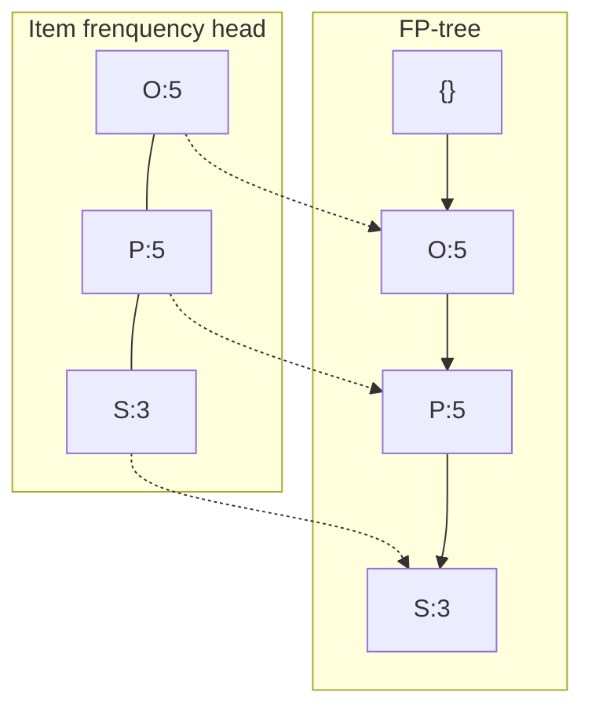

# 2022 数据仓库与数据挖掘 A 卷答案

by Albert Yang

一、min_sup= 60% x 5 = 3，min_conf = 75%

(a) Apriori 算法找出所有的频繁项目集

C1:

| itemset | sup  |
| ------- | ---- |
| {O}     | 5    |
| {P}     | 5    |
| {Q}     | 2    |
| {R}     | 2    |
| {S}     | 3    |
| {T}     | 1    |

L1:

| itemset | sup  |
| ------- | ---- |
| {O}     | 5    |
| {P}     | 5    |
| {S}     | 3    |

C2:

| itemset | sup  |
| ------- | ---- |
| {O, P}  | 5    |
| {O, S}  | 3    |
| {P, S}  | 3    |

L2:

| itemset | sup  |
| ------- | ---- |
| {O, P}  | 5    |
| {O, S}  | 3    |
| {P, S}  | 3    |

C3:

| itemset   | sup  |
| --------- | ---- |
| {O, P, S} | 3    |

L3:

| itemset   | sup  |
| --------- | ---- |
| {O, P, S} | 3    |

所有频繁项目集为：

1项集：{O}, {P}, {S}

2项集：{O, P}, {O, S}, {P, S}

3项集：{O, P, S}

(b) 根据上述所产生的频繁项目集有如下规则 

| 规则       | conf |
| ---------- | ---- |
| O => P     | 5/5  |
| P => O     | 5/5  |
| O => S     | 3/5  |
| S => O     | 3/3  |
| P => S     | 3/5  |
| S => P     | 3/3  |
| O => P & S | 3/5  |
| P & S => O | 3/3  |
| P => O & S | 3/5  |
| O & S => P | 3/3  |
| S => O & P | 3/3  |
| O & P => S | 3/5  |

满足min_conf=80%的规则如下：

| 规则       | conf |
| ---------- | ---- |
| O => P     | 5/5  |
| P => O     | 5/5  |
| S => O     | 3/3  |
| S => P     | 3/3  |
| P & S => O | 3/3  |
| O & S => P | 3/3  |
| S => O & P | 3/3  |

(c) 用 FP-Growth 算法找出频繁项

排序后的 L1：

| Itemset | sup  |
| ------- | ---- |
| O       | 5    |
| P       | 5    |
| S       | 3    |

交易商品排序：

| 顾客号 | 交易商品集合排序后 |
| ------ | ------------------ |
| 1      | {O, P,  S}         |
| 2      | {O, P,  S}         |
| 3      | {O, P,  S}         |
| 4      | {O, P}             |
| 5      | {O, P}             |

生成一个 F-list= O-P-S

(d) 从组件化思想的角度，比较 Apriori 算法和 FP-Growth 的异同

|                | Apriori            | FP-Growth      |
| -------------- | ------------------ | -------------- |
| 任务           | 关联模式发现       | 关联模式发现   |
| 模型/模式 结构 | 关联规则           | 关联规则       |
| 评分函数       | 支持度，置信度     | 支持度、置信度 |
| 搜索与优化算法 | 带剪枝宽度优先搜索 | 深度优先搜索   |
| 数量管理       | 无                 | 无             |

二、K-means 聚类

(a) 计算采用向下取整

第一次迭代：

| 点 中心 | A1(3, 9) | A2(2, 7) | A3(6, 9) | A4(1, 3) | A5(4, 9) | A6(2, 7) |
| ------------ | -------- | -------- | -------- | -------- | -------- | -------- |
| A1(3, 9)     | **0**    | **3**    | 3        | **8**    | 1        | **3**    |
| A3(6, 9)     | 3        | 6        | **0**    | 11       | 2        | 6        |
| A5(4, 9)     | 1        | 4        | 2        | 9        | **0**    | 4        |

簇1为：A1(3, 9), A2(2, 7), A4(1, 3), A6(2, 7)，更新中心为：(2, 6)

簇2为：A3(6, 9)，中心为：(6, 9)

簇3为：A5(4, 9)，中心为：(4, 9)

第二次迭代：

| 点 中心 | A1(3, 9) | A2(2, 7) | A3(6, 9) | A4(1, 3) | A5(4, 9) | A6(2, 7) |
| ------------ | -------- | -------- | -------- | -------- | -------- | -------- |
| (2, 6)       | 4        | **1**    | 7        | **4**    | 5        | **1**    |
| A3(6, 9)     | 3        | 6        | **0**    | 11       | 2        | 6        |
| A5(4, 9)     | **1**    | 4        | 2        | 9        | **0**    | 4        |

簇1为：A2(2, 7), A4(1, 3), A6(2, 7)，更新中心为：(1, 5)

簇2为：A3(6, 9)，更新中心为：(6, 9)

簇3为：A1(3, 9), A5(4, 9)，更新中心为：(3, 9)

(b) K-means 缺点与改进

- 在更新中心里时，采用算法平均，所以对噪声敏感，如：1，2， 100，平均为34。对于此可以改为 median
- 需要预先输入 K 值，对于有些数据来说，很难预先知道 K 值，对此可以采用密度估计方法

三、序列挖掘

- 子序列
  - 所谓子序列，是原始序列中按相同次序但不一定连续的元素组成的序列。
- 判定A是否是B的子序列
  - 序列 A 中的元素按相同次序是否出来在序列 B 中，如果出现则序列 A 是序列 B 的子序列，否则不是。
- 序列\<ad>
  - 10，30
- \<ad>的支持度
  - 2/4 = 50%

- <(ab)>的支持度
  - 2/4 = 50%

四、决策树建树过程与决策过程

- 建树过程
  1. 选择一个特征作为根节点：从训练数据中选择一个具有最好划分能力的特征作为根节点，ID3 通过计算各个特征的信息增益来判断哪一个是最好的划分特征的根据。
  2. 根据选定的特征划分数据集：将训练数据集根据选定的特征进行划分，得到多个子数据集，每个子数据集对应于选定特征的一个取值。
  3. 对每个子数据集递归建立子树：对每个子数据集，重复步骤1和步骤2，直到满足停止条件。停止条件可以是达到预定的树尝试、样本数量不足以继续划分、或者节点中的样本属于同一类别等
  4. 构建出完整的决策树：当递归建树过程结束后，得到一个完整的决策树模型。
- 决策过程：
  1. 从根节点开始，根据节点的特征判断新样本应该向左子树还是右子树移动。
  2. 沿着选择的路径继续移动，直到达到叶节点。
  3. 根据叶节点的类别输出预测结果