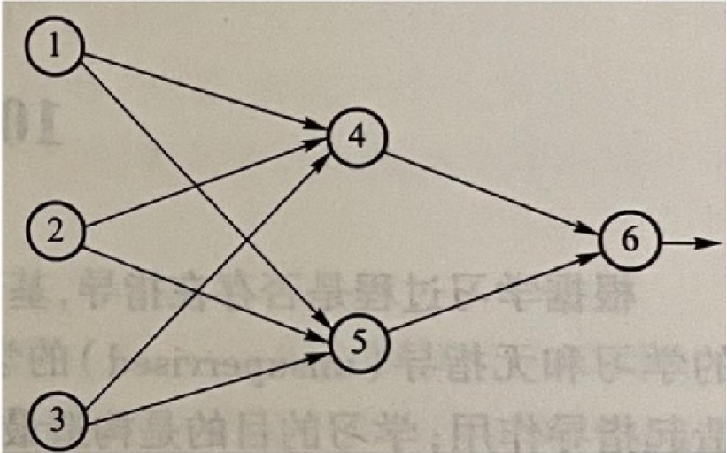

## 习   题   8

1. **什么是支持度？什么是置信度？**

2. **关联规则有哪几种分类方法？**

3. **为什么频繁子集的非空子集一定是频繁的？请给出公理1的证明过程。**

4. **现有如下事务数据库，设min_sup=60%，min_conf=80%，试用Apriori算法找出所有的频繁项集。**

| TID  | Items bought       |
| ---- | ------------------ |
| T100 | {M, O, N, K, E, Y} |
| T200 | {D, N, K, E, Y}    |
| T300 | {M, A, K, E}       |
| T400 | {M, U, C, K, Y}    |
| T500 | {C, O, K, I, E}    |

5. **针对第4题的事务数据库，试用FP-Growth 算法找出所有的频繁项集，并比较这两种算法的性能。**

6. **什么是多层关联规则?什么是多维关联规则?**

7. **简述如何从客观和主观两方面来评估关联规则的兴趣度。**

8. **什么是序列模式挖掘?举例说明序列模式挖掘和关联规则挖掘在统计项集频度时有何异同**

9. **简述GSP 和PrefixSpan两种序列模式挖掘算法的基本思想，并从组件的角度比较其异同。**

10. **现有如下事务数据库，设最小频度为2,试用GSP 算法找出所有的最大频繁序列。**

| 顾客号 | 交易时间                                    | 购物事件              |
| ------ | ------------------------------------------- | --------------------- |
| 0001   | 2010-03-06   2010-04-07                  | A   A、B、C        |
| 0002   | 2010-04-23    2010-04-27   2010-04-29 | C   B、C   A、E |
| 0003   | 2010-05-02                                  | E、B、C               |
| 0004   | 2010-06-04   2010-06-21                  | E、F   D、F、E     |

**11.什么是频繁子图挖掘?其主要的算法有哪些?**

## 习   题   9

1. 什么是分类？常用的分类模型有哪些？

2. 什么是回归？常用的回归模型有哪些？

3. 决策树是如何进行分类的？在生成决策树时如何选择分裂变量？

4. 对于图9.9中的第三个数据子集(Age>40)，应进一步选择什么样的分裂变量？试给出信息增益的计过程。

5. 在表9.11所示的学校教员数据库表中，年龄属性已被离散化。假设职称代表类别属性，给定新元组"王品，30…40，中，6"。如果采用朴素贝叶斯分类法，则王品的职称应该是什么？试写出计算步骤。

| 姓名 | 年龄  | 收入 | 工作年限 | 职称   |
| ---- | ----- | ---- | -------- | ------ |
| 钟时 | 30…40 | 中   | 5        | 副教授 |
| 王平 | <30   | 中   | 4        | 讲师   |
| 李乾 | 30…40 | 低   | 6        | 讲师   |
| 刘丽 | 30…40 | 中   | 5        | 副教授 |
| 杨光 | >40   | 高   | 8        | 教授   |
| 胡莎 | <30   | 低   | 7        | 副教授 |
| 鲁华 | 30…40 | 中   | 5        | 讲师   |
| 王洋 | 30…40 | 中   | 6        | 副教授 |
| 吴霞 | >40   | 高   | 6        | 教授   |
| 王亮 | >40   | 中   | 5        | 副教授 |
| 郭璇 | <30   | 高   | 6        | 讲师   |

6. 简述支持向量机分类的工作原理。

7. 三层神经网络是如何实现分类的?

8. 图9.21给出了一个三层前馈神经网络的例子。设学习率为0.8。网络的初始权值和偏置值在表9.12中给出。现在假设有一个样本，它的输入变量 $X=\{0,0,1\}$,  目标变量 $Y=1$ (即分类标号为1）。试给出反向传播算法针对该样本的迭代过程。

   
   
   
   
   | 连接     | 权值 | 单元       | 偏置 |
   | -------- | ---- | ---------- | ---- |
   | $W_{14}$ | -0.1 | $\theta_4$ | -0.1 |
   | $W_{24}$ | 0.2  | $\theta_5$ | 0.2  |
   | $W_{34}$ | 0.1  | $\theta_6$ | 0.1  |
   | $W_{15}$ | -0.2 |            |      |
   | $W_{25}$ | 0.3  |            |      |
| $W_{35}$ | 0.2  |            |      |
   | $W_{46}$ | 0.1  |            |      |
| $W_{56}$ | -0.1 |            |      |
   
9. 简述本章所介绍的各种分类方法的优缺点

## 习   题  10

1. 聚类和分类的区别是什么？它们之间有什么联系？

2. 什么是对象间的相似度？简述如何计算下列不同类型的对象间的相似度：(1)区间标度型；(2)二元型；(3)分类型；(4)序数型；(5)比例型；(6)混合型。

3. 给定两个对象(12，1，42)和(50，2，34)，试算出它们之间的欧几里得距离、曼哈顿距离，明科斯基距离(设q=3)。

4. 根据能找出的簇的形状、预先指定的参数及所存在的缺陷，对如下聚类方法进行评价：(1)k-Means；(2)BIRCH；(3)DBSCAN。

5. 假设有如下9个数据对象：$A_1$(1，10)，$A_2$(3.5)，$A_3$(4，3)；$B_1$(7，0)，$B_2$(7，3)，$B_3$(3，9)；$C_1$(3，2)，$C_2$(3，9)，$C_3$(4，4)。如果将 $k$ 设为3，初始的簇中心设为 $A_1$、$B_1$，和 $C_1$，并采用欧几里得距离函数，试用 k-Means 算法给出第一次迭代后的三个聚类中心和最后的聚类结果。

6. BIRCH算法是否能够检测出任意形状的簇？如果不能，能否对其进行改进，使其能够检测出任意形状的簇？

7. 什么是基于密度的聚类？简述如何将该类方法应用于检测噪声数据。

8. 什么是话题检测？话题检测的两个关键任务是什么？

9. 简述用PLSA方法进行话题检测的主要过程。

   

## 习题 12

5. 深度学习模型与传统的浅层学习模型的区别有哪止？
6. 举例说明卷积神经网络是如何进行卷积计算的。
7. LeNet-5 是一种典型的卷积神经网络，试述将其应用于手写数字识别的工作过程。
8. 循环神经网络的结构如何体现“循环反馈”的思想？
9. 试着给出一种常见的 LSTM 人工神经网络的结构。

