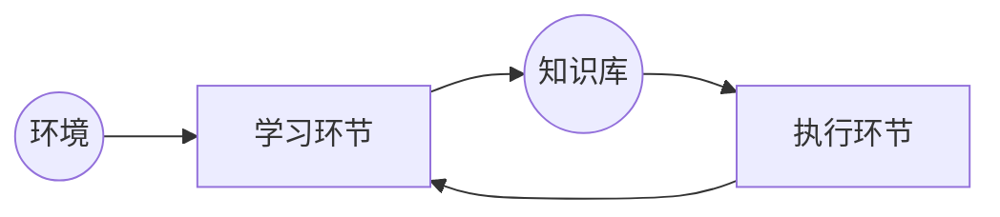

[TOC]


# 人工智能

## 第一章 绪论

1. 人工智能作为一门学科，在（1956）诞生于（ Dartmouth ）。LISP 语言是（1960）年提出的，MYCIN 的诞生地是 （Stanford University）。
2. 什么是人类智能？它有哪些特征或特点？
  - 所谓人类智能，是指人类所具有的**智力**和**行为**能力，这种能力和行为能力是以**知识**为基础的。智力行为的目的是获取知识，并用知识去求解问题。
  - 人类智能的特点有**感知**能力、**记忆与思维**能力、**归纳与演绎**能力、**学习**能力以及**行为**能力
3. 人工智能是何时、何地、怎样诞生的？
  - **1956**年，在美国 **Darthmouth** 大学。学术会议
4. 什么是人工智能？它的研究目标是什么？
  - 人工智能，就是有**人工的方法**在**机器**（计算机）上**实现智能**。机器智能。
  - 目标是构造可**实现人类智能**的智能**计算机**或智能系统
5. 人工智能有哪些主要研究领域？
  - 问题求解、机器学习、专家系统、模式识别、自动定理证明、自动程序设计、自然语言理解、机器人学、人工神经网络、智能检索、决策支持系统等
6. 人工智能有哪几个主要学派？各自的特点是什么？
  - 符号主义
    - 逻辑主义或计算机学派。认为人类的智能的**基本单元**是**符号**，认知过程就是符号表示下的**符号计算**，从而思维就是**符号计算**。其研究内容是基于逻辑的知识表示 和推理机制。
  - 联结主义
    - 又称仿生学派。认为人类的智能的基本单元是**神经元**，认知过程是由神经元构成的网络的**信息传递**，这种传递是并行分类进行的。基原理主要是神经网络及神经网络间的连接机制与学习算法。
  - 行为主义
    - 进化主义或控制论学派。认为智能取决于感知和行为，不需要知识、不需要表示、不需要推理。其原理是控制论和感知 – 动作型控制系统。
7. 什么是以符号处理为核心的方法？
   - 以符号处理为核心的方法又称为符号主义或自上而下的方法。认为人对客观世界认识的是符号，而且认知过程即是符号操作的过程，思维也可以看做是符号计算，人本身就是一个物理符号系统。
8. 什么是以网络连接为主的连接机制方法？
   - 又称为自下而上方法或联结主义。是在人脑神经元及其相互联结而成的网络的启示下，试图通过许多人工神经元的相互连接和相互作用来模拟人类智能。

## 第二章 知识表示方法

1. 什么是知识？它有哪些特性？有哪几种分类方法？
   - 知识是人们把实践中获得的信息关联在一起所形成的信息结构 ，是构成智能的基础。知识是用信息表达的，信息则是用数据表达的。有格式的数据经过处理、解释过程会形成信息，而把有关的信息关联在一起，经过处理过程就形成了知识。
   - 特性有：相对正确性，不确定性，可表示性和可利用性。
   - 分类：
      - 作用范围来划分，常识性知识和领域性知识。
      - 作用及表示来划分，确定知识和不确定知识。
      - 人类的思维及认识方法来分，逻辑性知识和形象性知识。
   
2. 何谓知识表示？陈述性知识表示法与过程性知识表示法的区别是什么？
   - 是研究用机器 表示的知识的可行性、有效性的一般方法，是一种数据结构与控制结构的统一体。知识表示实际上就是对人类知识的一种描述，以把人类知识表示 成计算机能够处理的数据结构。对知识进行表示的过程就是把知识编码成某种数据结构 的过程。
   - 陈述性知识表示主要用来描述事实性知识。就是将对象的有关事实“陈述”出来，并以数据的形式表示。将知识的表示与知识的运用（推理）分开处理。是一种静态的描述方法。优点：灵活、简洁，演绎过程完整而确定、系统的模块性好。缺点：工作效率低，推理过程不透明，不易理解。
   - 过程性知识表示主要用来描述规则性知识和控制结构知识。就是告诉人位“怎么做”，表示的形式是一处“过程”，这一“过程”就是求解程序。表示与运用（推理）相结合，是一种动态的描述方法。优点：推理过程直接、清晰，有利于模块化，易于表达启发性知识和默认推理知识，效率高。缺点：不够严格，知识间有交互重叠，灵活性差，知识的增、删操作极不方便。
   
3. 在选择知识的表示方法时，应该考虑哪些主要因素？
   - 能否充分表示相关的领域知识
   - 是否有利于对知识的利用
   - 是否便于知识的组织、维护和管理
   - 是否便于理解和实现
   
4. 一阶谓词逻辑表示法适合于表示哪种类型的知识？它有哪些特点？
  
   - 表示**确定性**的知识。具有**自然性**、**精确性**、**严密性**及**易实现**等特点。
   
5. 请写出用一阶谓词逻辑表示法表示知识的步骤。
   - 定义谓词及个体，确定每个谓词及个体的确切含义。（**定义**）
   - 根据所表达的事物或概念，为每个谓词中的变元赋以特定的值。（**符号化**）
   - 根据所表达的知识的语义，用适当的连接符号将各个谓词连接起来，形成谓词公式。（**写出谓词公式**）
   
6. 产生式的基本形式是什么？它与谓词逻辑中的蕴含式有什么共同处及不同处？
   - IF P THEN Q 或者是 $P \rightarrow Q$，P 是前提，用于提出产生式是否可用的条件，Q是一组结论或操作，用于指出前提P所指示的条件被满足时，应该得出的结论或应用执行的操作。
   - 蕴含式与产生式具体相同的形式。蕴含式只能表示**确定性**的知识。产生式可以表示**确定性与不确定性**的知识。蕴含式前提条件的匹配问题要求**精确匹配**，而产生式可以是**不精确匹配**的。蕴含式有**真值**，产生式本身**没有真值**。
   
7. 何谓产生式系统？它由哪几部分组成？

   - 把一组产生式放在一起，让它们相互配合，协同作用，一个产生式生成的结论可以供另一个产生式作为已知事实使用，以求得问题的解。
   - 规则库，综合数据库和推理机

8. 产生系统中，推理机的推理方式有哪几种？在产生式推理过程中，如果发生策略冲突，如何解决？

   - 正向推理，反向推理，双向推理（混合推理）
   - 专一性排序，规则排序和就近排序

9. 何谓语义网络？语义网络表示法的特点是什么？

   - 语义网络是通过概念及其语义关系来表示知识的一种网络图，它是一个带标注的有向图。
   - 结构性，自然性，联想性和非严格性

10. 语义网络表示法与产生式表示法、谓词逻辑表示法之间的关系如何？

   - 语义网络用三元组（节点1，弧，节点2）来表示，三元组可以写成一组一阶二元谓词。
   - 产生式表示法以一条产生式规则作为知识的单位，各条产生式规则之间**没有直接的联系**。而语义网络则不同，它不仅将基本网元视为一种知识的单元，而且各个基本网元之间又是**相互联系**的。

11. 何谓框架？框架的一般表示形式是什么？

    - 框架是一种描述所论对象发生的数据结构。所论的对象可以是一个事物、一事件或一个概念，
    - 框架由若干个“槽”组成，每个“槽”又可划分为若干个“侧面”。一个槽用于描述所论及对象的某一方面的属性，一个侧面用于描述相应属性的一个方面。
    - 槽和侧所具有的属性值分别称为槽值和侧面值。

12. 框架表示法有何特点？请叙述用框架表示法表示知识的步骤。

    - 结构性，继承性，自然性。
    - 步骤如下
       - 分析特表达知识中的对象及其属性，对框架中的槽进行合理设置
       - 对各对象间的各种联系进行考察。用常用的名称来描述上、下层框架间的联系
       - 对各层对象的“槽”及“侧面”进行合理的组织安排，避免信息描述的重复

13. 试写出“学生框架”的描述。

    - 框架名：<学生>
       姓名：单位（姓和名）
       年龄：单位（岁）
       性别：范围（男，女）
       	 缺省（男）
       健康状况：范围（健康，一般，差）
       	 缺省（一般）
       所在系别：单元（系）
       专业：范围（系中所包含的专业列表）
       入学时间：单位（年，月）
       毕业时间：单位（年，月）
       成绩：范围（优，良，中，差）
       	缺省（良）
       是否学生干部：范围（是，否）
       	缺省（否）
    
14. 框架系统中求解问题的一般过程是什么？

    - 把待求解问题用一个框架表示出来，其中有的槽是空的，表示待求解的问题，称做未知处。
    - 与知识库中已有的框架进行匹配。槽名及槽值进行逐个的比较实现的。比较的结果可能不是完全匹配，如果两个框架的各对应槽没有矛盾或者满足预先规定的某些条件，就认为这两个框架可以匹配。找出一个或几个可匹配的预先框架作为初步假设，在初步假设的引导下收集进一步的信息
    - 使用一种评价方法对预先框架进行评价，以便决定是否接受它
    - 若接受，则与问题框架的未知版主相匹配的事实就是问题的解。

15. 何谓对象？何谓类？封闭及继承的含义是什么？

    - 对象就是由一组数据和与该组数据相关的操作构成的封装体或实体
    - 类在概念上是一种抽象机制，它是对一组相似对象的抽象。类由一组变量和一组操作组成，它描述了一组具有相同属性和操作的对象。类是一个相对的概念。
    - 继承是指一个类拥有另一个类的全部变量和操作。前者称为子类，后者称为父类，父类所具有的数据和操作可被子类继承 。
    - 封装是一种信息隐藏技术，是面向对象的主要特征，它把一切局部于对象的信息及操作都局限于对象之内，在外面是不可见的，对象之间除了互递信息之外，不再有其他联系。

## 第三章 归结推理方法

1. **什么是命题？**

   - 能确定**真假**的**陈述语句**称做命题

2. **什么是谓词？什么是谓词个体及个体域？函数与谓词的区别是什么？**

   - 谓词是用于刻画**个体性质、状态或个体间**的关系的。个体变元的取值范围称为个体域。
   - 谓词与函数从形式上看很相似。谓词具有逻辑值的**真或假**，而函数是从某个个体到另一个个体（按数据上的概念是从自变量到因变量）之间的**映射**。

3. **谓词逻辑和命题逻辑的关系如何？有何异同？**

   - 谓词逻辑和命题逻辑都是应用于人工智能的两种逻辑，对于知识的形式化表示。谓词逻辑是在命题逻辑的基础上发展起来的，命题逻辑可看做是谓词逻辑的一种特殊形式。
   - 命题逻辑无法把所描述的客观事物的结构及逻辑特征反映出来，也不能把不同事物的共同特征表示出来。存在较大的局限性。谓词逻辑则消除了命题逻辑的局限性，将原子命题分解为谓词与个体两部分。个体是指可以独立存在的物体，它可以是抽象的，也可以是具体的。谓词则是用于刻画个体的性质、状态或个体间的关系的。

4. **什么是范式？请写出前束型范式与Skolem范式的形式。**

   - 范式就是标准型。

   - 它的所有题词均非否定地出现在公式的最前面，且它的辖域一直延伸到公式之末，同时公式中不出现在连接词（$\rightarrow 与\leftrightarrow$），这种形式的公式称做前束形范式，一般形式是
      $$
      (Q_1 x_1)(Q_2x_2)\cdots(Q_nx_n) \text{M}(x_1, x_2, \cdots, x_n)\notag
      $$
      其中，$Q_i$ 是存在量词或全称量词，而母式 $\text{M}(x_1, x_2, \cdots, x_n)$ 不再含有量词。

   - 从前束形范式中消去全部的存在量词所得到的公式称为 Skolem 标准型，它的一般形式是
     $$
     (\forall x_1)(\forall x_2)\cdots(\forall x_n) \text{M}(x_1, x_2, \cdots, x_n)\notag
     $$
   
5. **归结过程控制策略的要点**

   1. 要解决的问题是归结方法的知识爆炸；
   2. 控制策略的目的是归结点尽量少；
   3. 控制策略的原则是删除不必要的子句，或对参加归结的子句加以限制；
   4. 给出控制策略，以便选择合适的子句对其做归结，避免多余的、不必要的归结式出现。

6. **删除策略**

   1. 归类：简单理解为，由于小的可以代表大的，所以小的吃掉大的
   2. 归结过程中可以随时删除的子句：
      1. 含有永真式的子句
      2. 被子句集中其他子句归类的子句
   3. 完备的

7. **采用支撑集策略**

   1. 支撑集的定义是：设有不可满足子句集 $S$ 的子集 $T$，如果 $S-T$ 是可满足的，则称 $T$ 是 $S$ 的支撑集。
   2. 思想就是尽量避免在可满足的子句集中进行归结，因为从中推导不出空子句。支撑集策略一般是以目标公式的否定的子句作为支撑集，由此出发进行归结。归结过程中，只选择不同时属于 $S-T$ 的子句对，在其间进行归结。就是说，至少有一个子句来自支撑集 $T$ 或由 $T$ 导出的归结式。
   3. 完备的。如何寻找合适的支撑集。

8. **语义归结策略**

   1. 语义归结策略是将子句 $S$ 按照一定的语义分成两部分，约定每部分内的子句间不允许进行归结。
   2. 完备的。如何寻找合适的语义分类方法。

9. **线性归结策略**

   1. 线性归结策略首先从子句集选取一个称作顶子句的子句 $C_0$ 开始进行归结。每次归结得到的新子句立即参加归结，而后再加入子句集等待再次参加归结。
   2. 完备的。重要的是，如何能够找到一个较好的顶子句。

10. **单元归结**

   1. 单元归结要在归结过程中，每次归结 都有一个子句是单元子句。
   2. 基本完备性（不完备），不是所有可以归结的谓词集全都可以采用单元归结策略进行归结。

11. **输入归结策略**

    1. 输入归结策略要求在归结过程中，每一次归结的两个子句中必须有一个是 $S$ 的原子句。
    2. 不完备

## 第四章 不确定推理方法

1. 什么是不确定性推理？有哪几类不确定性推理方法？不确定性推理中需要解决的基本问题有哪些？

   -  不确定推理就是从具有**不确定性的证据**出发 ，运用知识（或规则 ）库中的不确定性的知识，最终推出具有一定**程度的不确定性**，但却是合理的或近乎合理的结论的思维过程。
   - 不确定性推理分类：
      - 模型方法
        - 把不确定的证据和不确定的知识分别与某种度量标准对应起来，并给出更新结论不确定性的合适的算法
        - 可信度方法，主观 Bayes 方法和证据理论方法
      - 控制方法
        - 通过识别领域中引起不确定性的某此特征及相应的控制策略来限制或减少不确定性系统的产生的影响
        - 启发式搜索，相关性制导回溯
   - 不确定性推理中需要解决的基本问题有：
      - 不确定性的表示问题
         - 不确定性证据的表示和不确定性知识的表示
      - 不确定性的推理计算问题
         - 不确定性的传递计算算法、组合证据不确定性算法和结论不确定性的更新或合成算法
      - 不确定性度量问题
         - 用一定的数值来表示知识、证据和结论的不确定程度时，这种数值的取值方法和取值范围

2. 什么是可信度？由可信度因子 $\text{CF}(\text{H}, \text{E})$ 的定义说明它的含义。

   - 可信度就是人们在实际生活中根据自己的经验或观察对某一事件或现象为真的相信程度。
   - 可信度因子 $\text{CF}(\text{H}, \text{E})$ 是用来表示一条知识的可信度或规则强度。它的含义是表示由证据 $\text{E}$ 的出现使结论 $\text{H}$ 为真的可信度是增加了还是减少了。如果是增加了，则$%（&，’）()，并且$ $\text{CF}(\text{H}, \text{E}) > 0$，并且 $\text{CF}(\text{H}, \text{E})$ 的值越大，说明结论为真的可信度越大；相反，如果证据 $\text{E}$ 的出现使结论 $\text{H}$ 为假的可信度增加了，则使 $\text{CF}(\text{H}, \text{E}) < 0$，并且 $\text{CF}(\text{H}, \text{E})$ 的值越小，说明结论为假的可信度越大；若证据的出现与否和 $\text{H}$ 无关，则使 $\text{CF}(\text{H}, \text{E}) = 0$

3. 什么信任增长度？什么是不信任增长度？根据定义说明它们的含义。

   - 在专家系统 MYCIN 中，CF(H, E) 被定义为

   $$
   CF(H, E) = MB(H, E) - MD(H, E) \notag
   $$

   - MB（Measure Belief）称为信任增长度，它表示因与前提条件 E 匹配的证据的出现，使结论 H 为真的信任增长度。
     $$
     MB(H, E) = \begin{cases}1 & P(H) = 1 \\ \frac{\text{max}(P(H|E), \; P(H)) - P(H)}{1 - P(H)} &\text{otherwise} \end{cases} \notag
     $$
     
- MD（Measure Disbelief）称为不信任增长度，它表示因与前提条件 E 匹配的证据的出现，对结论 H 为真的不信任增长度。
     $$
     MD(H, E) = \begin{cases}1 & P(H) = 1 \\ \frac{\text{min}(P(H|E), \; P(H)) - P(H)}{- P(H)} &\text{otherwise} \end{cases} \notag
     $$
     

4. 当有多条证据支持一个结论是，什么情况下使用合成法求取结论的可信度？什么情况下使用更新法求取结论可信度？试说明这两种方法实际是一致的。

   解：

   - 若有多条不同的知识推出了相同的结论，但**可信度不同**，且对结论的**可信度一无所知**（可信度为 0）的情况下，可用**合成算法**求出结论的可信度。
   - 如已知证据 E 对结论 H 有影响，且知识 IF E THEN H 的可信度为 CF(H, E)，同时结论 H 原来的可信度为 CF(H)（CF(H) $\ne$  0），这时可使用更新法求取结论 H 的可信度。
   - 合成法只是在结论可信度为零的条件下才能使用，所以合成法可以说只是更新法的一个特例。如将 CF(H) 置 0，用更新法计算的结果与合成法是一致的。 

5. 设有如下一组推理规则：

   R1: IF E~1~ THEN E~2~  (0.6)

   R2: IF E~2~ AND E~3~ THEN E~4~ (0.8) 

   R3: IF E~4~ THEN H (0.7) 

   R4: IF E~5~ THEN H (0.9) 

   且已知 CF(E~1~) = 0.5, CF(E~3~) = 0.6, CF(E~5~) = 0.4, 结论 H 的初始可信度一无所知。

   求 CF(H)。

   解：

   ```mermaid
   graph BT
   E((E1 0.5)) --0.6--> E2((E2))
   E2 --> E4((E4))
   E3((E3 0.6)) --> E4
   E4 --0.7--> H((H))
   E5((E5 0.4)) --0.9--> H
   ```

   - 由 R1 可计算 E~2~ 的可信度：

     CF(E~2~) = CF(E~2~, E~1~) x max{0, CF(E~1~)}

     ​			= 0.6 x 0.5 = 0.3

   - 由 R2可计算 E~4~ 可的可信度

     CF(E~4~) = CF(E~4~, E~2~$\and$ E~3~) x max{0, CF(E~2~ $\and$ E~3~)}

     ​			= CF(E~4~, E~2~$\and$ E~3~) x max{0, min{CF(E~2~), CF(E~3~)}}

     ​			= 0.8 x 0.3 = 0.24

   - 由R3 R4 分别计算 CF(H)

     CF~1~(H) = CF(H, E~4~) x max{0, CF(E~4~}

     ​			= 0.7 x 0.24 = 0.168

     CF~2~(H) = CF(H, E~5~) x max{0, CF(E~5~}

     ​			= 0.4 x 0.9 = 0.36

   - 利用合成算法计算 CF(H)

     CF(H) = CF~1~(H) + CF~2~(H) - CF~1~(H) x CF~2~(H) 

     ​		  = 0.168 + 0.36 - 0.168 x 0.36 = 0.4675

6. 已知：规则可信度为

   R1: IF E~1~ THEN H~1~  (0.7)

   R2: IF E~2~ THEN H~1~ (0.6) 

   R3: IF E~3~ THEN H~1~ (0.4) 

   R4: IF (H~1~ AND E~4~) THEN H~2~ (0.2) 

   证据可信度为

   ​	CF(E~1~) = CF(E~2~) = CF(E~3~)  = CF(E~4~)  = CF(E~5~)  = 0.5

   H~1~ 的初始可信度一无所知，H~2~ 的初始可信度 CF~0~(H~2~) = 0.3。

   计算结论 H~2~ 的可信度 CF(H~2~)。

   解：

   ```mermaid
   graph BT
   E1((E1 0.5)) --0.7--> H1((H1))
   E2((E2 0.5)) --0.6--> H1
   E3((E3 0.5)) --0.4--> H1
   H1 --> H[/AND\]
   E4((E4 0.5)) --> H
   H --0.2--> H2((H2))
   ```

   CF~1~(H~1~) = CF(H~1~, E~1~) x max{0, CF(E~1~)} = 0.7 x 0.5 = 0.35

   CF~2~(H~1~) = CF(H~1~, E~2~) x max{0, CF(E~2~)} = 0.6 x 0.5 = 0.3

   CF~3~(H~1~) = CF(H~1~, E~3~) x max{0, CF(E~3~)} = 0.4 x 0.5 = 0.2

   CF~12~(H~1~) = CF~1~(H~1~)  + CF~2~(H~1~)  -  CF~1~(H~1~)  x CF~2~(H~1~)  

   ​			   = 0.35 + 0.3 - 0.35 x 0.3 = 0.545

   CF(H~1~) = CF~12~(H~1~)  + CF~3~(H~1~)  -  CF~12~(H~1~)  x CF~3~(H~1~)  

   ​		    = 0.545 + 0.2 - 0.545 x 0.2 = 0.636

   CF~1~(H~2~) = CF(H~2~, H~1~ $\and$ E~4~) x max{0, CF(H~1~, E~4~)}

   ​		    = CF(H~2~, H~1~ $\and$ E~4~) x max{0, min{CF(H~1~), CF(E~4~)}}

   ​			= 0.2 x max{0, min{0.636, 0.5)}} = 0.2 x 0.5 = 0.1

   CF(H~2~) = CF~1~(H~2~) + CF~0~(H~2~) - CF~1~(H~2~) x CF~0~(H~2~)  = 0.1 + 0.3 - 0.1 x 0.3 = 0.37

**4.12试说明概率分配函数、信任函数、似然函数的含义。**

​	答：在D-S 理论中，**信任函数**和**似然函数**是用来对命题的不确定性进行度量的。**信任函数**表示对命题**为真**的**信任程度**，而**似然函数**表示对命题**为非假**的信任程度。它们分别表示对命题信任程度的**下限和上限**。

​	引入概率分配函数，完全是为了定义信任函数和似然函数，以便实现对命题的不确定性的度量。也就是说信任函数和似然函数的定义是依赖于概率分配函数的，概率分配函数是对一个命题的**不确定度量**的**基础**。

**4.13 概率分配函数与概率相同吗? 为什么?**

​	答：概率分配函数不同于概率。因为在一个样本空间 D上,各子集的概率分配函数值可能是人为分配指定的，样本空间 D中各元素的基本概率数之和不一定等于1。


## 状态空间搜索策略

1. **什么是搜索？有哪两大类不同的搜索方法？两者的区别是什么？**

   答：

   - 搜索是一种求解问题的方法，是寻找从问题初始事实到最终答案的推理路线的一种过程。利用这种方法在求解问题时，要按照一定的策略，从知识库里寻找可利用的知识，从而构造出一条使问题获得解决的推理路线。
- 盲目搜索和启发式搜索
   - 盲目搜索又称无信息搜索，只按预先规定的搜索控制策略进行搜索，而没有任何中间信息来改变这些控制策略。搜索带有盲目性，效率不高。
   - 启发式搜索又称信息搜索，在搜索求解过程中产生的一些信息来不断地改变或调整搜索的方向，使搜索朝着最有希望的方向前进，加速问题的求解，并找到最优解。启发式搜索求解效率高，更易于求解复杂的问题。
   
2. **搜索方法汇总**

   1. **求作一解路的搜索策略**
      - **回溯法（backtracking）**
      - 爬山法（hill climbing）
      - **宽度优先法（breath-first）**
      - **深度优先法（depth-first）**
      - 限定范围搜索法（beam search）
      - 好的优先法（best-first）
   2. **求最佳解路的搜索策略**
      - 大英博物馆法（British Museum）
      - **分支界限法（branch and bound）**
      - 动态规则法（dynamic programming）
      - **最佳图搜索法（A*）**
   3. 求与或关系解图的搜索法
      - 一般与或图搜索法（AO*）
      - 极小极大法（minimax）
      - $\alpha-\beta$ 剪支法（alpha-beta pruning）
      - 启发式剪去法（heuristic pruning）

3. **回溯策略**

   1. 所谓回溯策略，简单地说是这样一种策略：
      1. 首先将规则 给出一个固定的排序 
      2. 在搜索时，对当前状态（开始时，是初始状态）依次检测每一条规则 ，在当前状态未使用过的规则中找到第一条可应用规则，应用于当前状态，得到新状态重新设置为当前状态
      3. 如果当前状态无规则可用，或所有规则已经被试探过仍示找到问题的解，则将当前状态的前一个状态设置为当前状态
      4. 重复以上搜索，直到找到问题的解，或者试探了所有可能后仍找不到问题的解为止。
   2. 其中递归法是一种直接的实现方法
   3. 与DFS的差别
      1. 回溯 = 树的深度优先搜索 + 剪枝
      2. 差别：DFS 用 visit 记录访问的点，每个位置只访问一遍；回溯对于已访问过的点，也可能再访问，其关键是访问有序，不同的序有不同的结果。

4. **一般图搜索算法**

   1. 从即初始结点开始，把初始结点加入 OPEN 表
   2. 设置 CLOSE 表，起始设置为 空表
   3. 开始循环，如果 OPEN 表为空，退出循环，失败退出
   4. 取出 OPEN 最开始的结点，记为当前结点，并加入到 CLOSE 表
   5. 如果当前结点是目标，只退出，返回成功；由当前结点返回到初始结点的路径，可给出解路径
   6. 扩展当前结点
   7. 标记和修改指针
      - 把扩展结点加入到 OPEN 表，并标记扩展结点的到当前结点指针
      - 计算机要修改的指针
      - 计算是否要修改扩展结点到后继节点的指针
   8. 对 OPEN 表中的结点按某种原则重新排序 
   9. 转到3循环

5. **用状态空间法表示问题时，什么是问题的解？求解过程的本质 是什么？什么是最优解？最优解唯一吗？**

   答：

   - 用状态空间法问题时，问题的解就是有向图中某一个节点（初始状态节点）到另一节点（目标状态节点）的路径。
   - 求解过程的本质就是对状态空间图的搜索，即在状态空间图上寻找一条从初始状态到目标状态的路径。
   - 在不考虑搜索的代价时，最优解就是解路径中长度最短的那条路径；在考虑搜索代价时，最优解就是解路径中代价最小的那条路径。在状态空间图中，可能存在几条长度或代价相等的最短解路径，所以最优解可能会不唯一。

6. **试写出状态空间图的一般搜索过程。在搜索过程中 OPEN 表 和CLOSE 表的作用分别是什么，有何区别？**

   答：

   - 在搜索过程中 OPEN 表用于存放未扩展节点，而 CLOSE 表用于存放已扩展节点。OPEN 表提供了待扩展节点，当 OPEN 表空且未找到目标切点时，搜索失败。而 CLOSE 表在搜索成功时为回溯求解路径提供依据。

7. **什么是盲目搜索？主要有几种盲目搜索策略？**

   答：

   - 盲目搜索又称无信息搜索，搜索过程中，只按预先规定的搜索控制策略进行搜索，而没有任何中间信息来改变这些控制策略。
   - 宽度优先搜索，深度优先搜索，有界深度优先搜索，代价树的宽度优先搜索和代价树的深度优先搜索

8. **宽度优先搜索与深度优化搜索有何不同？在何种情况下，宽度优先搜索优于深度优先搜索？在何种情况下，深度优先搜索优于宽度优先搜索？**

   答：

   - 区别在于，在对节点 $n$ 进行扩展时，其后继节点在 OPEN 表中存放的位置。宽度优先搜索是将后继节点放入 OPEN 表的末端，而深度优先搜索则是将后继结点放入 OPEN 表的前端。宽度优先按 “先进先出”，深度优先按 “后进先出”。宽度优先搜索是一种完备搜索，即只要问题有解就一定能够求出，而深度优先搜索是不完备搜索。
   - 在不要求求解速度且目标节点的层次较深的情况下，宽度优先搜索优于深度优先搜索。宽度优先搜索效率低，但却一定能够求得问题的解。
   - 在要求求解速度且目标节点的层次较浅的情况下，深度优先搜索优于宽度优先搜索。因为当搜索算法在一个扩展的很深但又没有解的分支上，进行搜索是一种无效的搜索，降低了求解的效率，有时甚至不一定能求得问题的解。

9. **什么是启发式搜索？什么是启发信息？**

   答：

   - 启发式搜索又称有信息搜索，它是指在搜索求解过程中，根据问题本身的特性或搜索过程中产生的一些信息来不断的改变或调整搜索的方向，使搜索朝着最有希望的方向前进，加速问题的求解，并找到最优解。
   - 可用于指导搜索过程且与具体问题求解有着的控制性信息称为启发信息。
   - 要对 OPEN 表进行排序，需要定一个评价函数来对各个子结点进行计算，估算出 “有希望” 的结点来

10. **什么是估价函数？估价函数中，$g(x)$ 和 $h(x)$ 各起什么作用？**

   答：

   - 估价函数是一种用来表示和度量搜索树中节点的 ”希望“ 程度的一种函数，其任务是估计待搜索节点的重要程度，为它们排定次序。
   - $g(x)$ 为初始节点 $S_0$ 到节点 $x$ 已经实际付出的代价。
     - $g(x)$ 项体现了搜索的宽度优先趋势，这有利于搜索算法的完备性，但不影响算法的搜索效率。
   - $h(x)$ 是从节点 $x$ 到目标节点 $S_g$ 最优路径的估计代价，搜索的启发信息主要由 $h(x)$ 来体现，所以 $h(x)$ 称为启发函数 。
     - $h(x)$ 项体现了搜索的深度优先趋势，不会有利于搜索效率的提高，但影响搜索算法的完备性。

11. **启发式搜索算法 A**

    启发式搜索算法 A，简单称 A 算法，基本思想：定义一个评价函数 $f$，对当前的搜索状态进行评估，找出一个最有希望的结点来扩展。评价函数为 $f(n) = g(n) + h(n)$。

    $g^*(n)$：表示从初始节点 $S_0$ 到当前结点 $n$ 的最短路径的耗散值；（较大则倾向宽度搜索）

    $h^*(n)$：表示从节点 $n$ 到目标结点 $S_g$ 的最短路径的耗散值；（较大搜索效率高，未必最优）

    $f^*(n) = g^*(n) + h^*(n)$：表示从初始节点 $S_0$ 经过节点 $n$ 到目标结点 $S_g$ 的最短路径的耗散值。

    每次按照 $f(n)$ 的大小对 OPEN 表中的元素进行排序，$f$ 值小的结点放到前面，而 $f$ 值大的结点则被放在 OPEN 表的后面，这样每次扩展结点时，总是选择当前 $f$ 值最小的结点来优先扩展。

12. **爬山算法**

    爬山算法不设 OPEN 表与 CLOSE 表，不考虑 $g(n)$，只将山顶作为目标，$h(n)$ 表示山顶与当前位置 $n$ 之间的高度之差，则该算法相当于总是登向山顶的，在单峰的条件下，必能达到山峰。

13. **分支界限法**

    分支界限法是优先扩展当前具有最小耗散值分支路径的端结点 $n$，其评价函数为 $f(n)=g(n)$。基本思想：建立一个局部路径（或分支）的队列 而非节点队列，每次都选择耗散值最小的那个分支上的端结点进行扩展，直到生成含有目标结点的路径为止。

14. **动态规则法**

    在 A 算法中，当 $h(n)\equiv 0$ 时，则 A 算法演变为动态规则算法，由于在 A 算法中，很多问题的启发函数 $h$ 难以定，因为动态规则仍然是至今一直被经常使用的算法，动态规则法实际上是对分支界限法的改进。

15. **什么是 A* 算法？它的代价函数是如何确定的？A* 算法与 A 算法的区别是什么？**

    答：

    - A* 算法是一种启发式搜索方法，利用这种算法进行搜索时，对扩展节点的选择方法做了一些限制 ，依据估价函数 $f(x) = g(x) + h(x)$ 对 OPEN 表中的节点进行排序 ，并要求启发函数 $h(x)$ 是 $h^*(x)$ 的一个下界，即 $h(x) \le h^*(x)$。$h^*(x)$ 则是从 $x$ 节点到目标节点的最小代价路径上的代价。A* 算法与 A 算法的区别就是 A 算法不要求启发函数  $h(x)$ 是 $h^*(x)$ 的一下界，即不限制条件 $h(x) \le h^*(x)$。
    - A* 算法实际上是分支界限和动态规则原理及使用下界范围的 $h$ 相结合的算法。

16. **A* 算法有哪些性质？它们的意义如何？**

    答：

    - A* 算法具有：可采纳性，单调性，信息性
    - 可采纳性，是指对一个可求解的状态空间图，即从状态空间图的初始节点到目标节点存在路径，则该算法一定上能在有限 步内找到一条最佳路径，即最优解，并在此路径上结束 。
    - 单调性，是指对其估计函数中的 $h(x)$ 部分即启发性函数，加了适当的单调性限制条件，使它对所扩展的一系列节点的估价函数值单调递增（或非递减），从而减少对 OPEN 表或 CLOSE 表的检查 和调整，提高搜索效率。
    - 信息性，是指其估价函数中的启发函数 $h(x)$ ，在满足 $h(x) \le h^*(x)$ 的前提下，$h(x)$ 的值越大越好。$h(x)$ 的值越大，表明它携带的与求解问题相关的启发信息越多，搜索过程就会在启发信息指导下朝着目标节点前进，所走的弯路越少，搜索效率就会提高。

17. **证明单调性启发策略是可采纳的。**

    证明：将状态空间的任意一条路径卸任是由一系列状态 $S_1, S_2, S_3, \cdots, S_g$ 组成的，其中 $S_1$ 是起始状态，$S_g$ 是目标状态。如果将 $S_{i+1}$ 看作是 $S_i$ 的子节点，则由搜索策略单调性可知，对启发函数  $h(x)$ 有如下限制 ：

    ​	（1）$S_1$ to $S_2$: $h(S_1) - h(S_2) \le \text{cost}(S_1, S_2)$

    ​			  $S_2$ to $S_3$: $h(S_2) - h(S_3) \le \text{cost}(S_2, S_3)$

    ​			  $\cdots$

    ​			 $S_{g - 1}$ to $S_g$: $h(S_{g - 1}) - h(S_g) \le \text{cost}(S_{g - 1}, S_g)$

    ​	（2）对目标节点 $S_g$，有 $h(S_g) = 0$

    ​		将（1）中所有竖式相加，并根据（2）中的 $h(S_g) = 0$，得到：
    $$
    \text{Path} \; S_1 \; \text{to}\; S_g: h(S_1) \le \text{cost}(S_1, S_g) \notag
    $$
    ​		这就说明，单调性启发搜索策略中的记性函数 $h(x)$ 满足 A* 算法的要求，因而它是可采纳的。

    ​		证毕。

    

## 机器学习

### 要点

- 机器学习就是计算机自动获取知识，是人工智能中的一个重要研究领域。要求理解机器学习的舍义以及它在人工智能研究领域的意义;了解机器学习研究的发展历史及其研究现状，弄清机器学习的问题所在
- 掌握机器学习的基本原理以及机器学习系统的基本模型。
- 了解机器学习的传统方法以及各种方法之间的区别与联系。深入了解基于实例学习的两空间模型及其基本原理，掌握两空间的描述及搜索方法以及它们的相互联系。
- 了解 ID3 判定树方法的原理。

### 习题

**6.1 什么是学习？有哪几种主要观点？**

​	答：学习是一个有特定目标的知识获取过程，其内在行为是获取 知识、积累经验、发现规律，其外在表现是使系统性能得到改进、系统实现自我完善、自适应环境。

**6.2 什么是机器学习？机器学习研究的目标是什么？研究机器学习的意义何在？**

​	答：

- 机器学习是研究如何使用计算机模拟人类学习活动的一门学习。就是研究计算机获取 新知识和新技能、识别现有知识、不断改善性能、实现自我完善的方法。

- 机器学习研究的目标有3个：
  - 人类学习过程的认知模型
    - 对人类学习机理的研究。不仅对人类的教育，而且对开发机器学习系统都有重要的意思
  - 通用学习算法
    - 对人类学习过程的研究，探索各种可能的学习方法，建立起独立于具体应用领域的通用学习算法
  - 构造面向任务的专用学习系统的方法
    - 解决专门的实际问题，并开发完成这些专门任务的学习系统
- 机器学习是人工智能中最具智能特征、最前沿的研究领域之一。机器学习的研究取得重大进展往往意味着人工智能，甚至整个计算机科学向前迈进了坚实的一步。机器学习速度快、便于知识积累、学习结果易于传播，因此人类在机器学习领域的每一点进步，都会使计算机的能力显著增强，从而对人类社会产生影响，尤其对今天信息化社会来说，这种影响将是十分深远的。

**6.3 机器学习的研究经历了哪几个阶段?**

​	答：

- 自从20世纪50年代开始研究机器学习以来，经过了几个不同的发展时期，若以它的研究目标和研究方法来划分，可分为4个阶段。分别 是：神经元模型和决策理论；符号概念获取 ；知识增强和论域专用学习；连接学习。

**6.4 机器学习有哪些主要学习策略?**

​	答：策略有：记忆学习（又称机械学习），传授学习，演绎学习，类比学习和归纳学习。归纳学习又分为实例学习，观察与发现学习。

**6.5 试述机器学习系统的基本结构，并说明各部分的作用。**

​	答：




**6.6 机械学习的基本思想是什么?在设计机械学习系统时，要考虑哪些问题?**

​	答：机械学习的基本思想就是直接记或存储环境提供的新知识，在以后求解问题时，直接通过对知识库的检索 来使用这些知识，而不再需要进行任何的计算和推导。

- 记忆则是简化数据计算处理，以空间换取时间的手段。设计要考虑三个问题：存储结构，环境的稳定性和存储信息的适用性，以及存储与计算的权衡

**6.7什么是传授式学习？传授式学习的学习过程包括哪些步骤?**

​	答：又称为指点学习或嘱咐式学习。由外部环境向系统 提供一般性的指示或建议，系统把它们具体地转化为细节知识，并加入知识库中。在学习过程中要反复对形成的知识进行评价，使其不断完善。

- 5个步骤：
  1. 征求教授者的指示或建议
  2. 解释：就是把教授者的建议转成内部表示形式，属知识表示问题
  3. 实用化：它把抽象的建议转成具体的知识，信息变换的过程
  4. 加入知识库：把得到的新知识加入知识库，并在加入过程中，对知识进行一致性检查 ，以防出现矛盾、冗余、环路等问题
  5. 评价：实用化得到的新知识往往是假设，还要对其进行验证和评价。如果评价出现了问题，就要进行故障分析和知识库修改。

**6.8 简述类比学习的基本思想。利用类比学习可以学习哪些东西？利用类比学习策略学习新概念的步骤是什么？**

​	答：类比学习就是通过类比 ，即通过对相似事物进行比较所进行的一种学习，它有一个基本的假设，即人们遇到的一个新问题，都会联想起一些以前遇到过的问题，这些问题和新问题的抽象级别虽然不一定相同，但它们具有一定程度上的相似性。人们会希望以前的解决问题的行为也能适用于新的问题的求解。

- 步骤：
  - 首先从知识库中找到类似的分概念或技巧，
  - 然后把它们转换为新形式以便用于新情况

**6.9 利用类比学习策略学习问题的求解方法时，一般有几种类比法？简述变换类比法的思想。**

​	答：类比法一般有2种：变换类比法，推导类比法

- 变换类比法主要由回忆过程与变换过程。回忆过程用于找出新旧问题间的差别
  - 新、旧问题初始状态的差别
  - 新、旧问题目标状态的差别
  - 新、旧问题路径约束的差别
  - 新、旧问题求解方法可应用度的差别
- 差别越小，表示两者越相似。变换过程是把旧问题的求解方法经过适应变换后，使之成为求解问题的求解方法。变换时，其初始状态是新问题类似的旧问题的解，即一个算符序列，目标状态是新问题的解。变换中要用 “中间——结局分析” 法来减少目标状态与初始状态间的差异，使初始状态逐步过渡到目标状态，即求出新问题的解。

**6.10 什么是归纳学习？归纳学习一般又可分为哪两种学习形式？**

​	答：归纳学习是应用归纳推理进行学习的一类学习方法。按其有无老师指导可分为实例学习和观察与发现学习两种形式。

**6.11 实例学习的基本思想是什么？在实例学习中提供正、反例的信息源有哪些？简述实例学习的两个空间模型，这两个空间之间的关系如何？在设计例子空间和规则空间时要考虑哪些问题?**

​	答：实例学习是通过从环境中取得若干与某概念有关的例子，经归纳得出一般性概念的一种方法。实例学习系统能够从外部信息源提供的特殊的正例和反例出发，进行归纳推理，得到一般的规则或一般性的知识，这些一般性知识应能解释所有给定的正例，并排除所有给定的反例。

- 一般情况下，提供正例和反例的信息源有3种：a. 已经知道的概念的老师；b. 学习者本身；c. 学习者以外的外部环境

- 涉及两个空间：例子空间和规则空间

  ```mermaid
  graph LR
  A["选择例子"] -->  B(("例子空间")) 
  B --> C["解释例子"]
  C --> D(("规则空间"))
  D --> A
  ```

  


- 设计例子空间时，要考虑两个问题，一个是示教例子的质量；另一个是例子空间的组织与搜索方法。设计规则空间也要考虑两个问题，一个是对规则空间的构成以及其中的规则表示方法的要求；另一个是规则空间的搜索方法的选择。

**6.12 对规则空间进行搜索的方法有几种？变形空间法的基本原理是什么？它有什么优点？**

**6.13 观察与发现学习策略可以学习哪些方面的知识?**

**6.14 什么是解释学习？其学习过程是什么？**

​	答：解释学习是一种演绎学习方法。这种方法通过运用相关的领域知识，对当前提供的单个问题求解实例进行分析,构造出求解过程的因果解释结构,并通过对该解释结构一般化处理获取相应知识，以便用于指导以后求解类似的问题。解释学习的过程包括两个步骤: (1) 通过求解一个例子来构造解释结构。(2) 对所得到的解释结构进行一般化处理，从而获取一般性的知识或概念。

## 自然语言理解

**7.1什么是自然语言？自然语言是由哪些要素构成的？**

​	答：自然语言是音、形、义结合的词汇和语法体系，是人类实现思维活动的物质表现形式。词汇和语法是构成自然语言的两大要素。

**7.2什么是自然语言理解？自然语言理解过程有哪些层次，各层次的功能如何?**

​	答：自然语言理解就是研究如何让计算机理解人类自然语言的一个研究领域。

- 自然语言理解过程有 3 个层次：词法分析、句法分析和语义分析。
  - 词法分析：主要目的是找出词汇的各个词素，从中获得语言学信息。
  - 句法分析：对句子或短语的结构进行分析，以确定构成句子的各个词、短语之间的相互关系以及各自在句子中的作用。
  - 语义分析：通过分析找出词义、结构意义及其结合意义，从而确定语言所表达的真正含义或概念。

## 专家系统

**8.1什么是专家系统？它有哪些基本特点？**

​	答：专家系统是一种具有大量专门知识与经验的**智能程序**，它能运用某个领域一个或多个专家多年积累的经验和专门知识，模拟领域专家求解问题时的思维过程，以解决该领域中的各种复杂问题：

- 特点：
  1. 启发性
  2. 透明性
  3. 灵活性
  4. 交互性
  5. 推理有效性
  6. 复杂性
  7. 实用性
  8. 知识的专门性
  9. 易推广性

**8.2对专家系统的分类有哪几种方法？它们都可以分为哪几种主要类型？**

**8.3一般专家系统由哪些基本部分构成？每一部分的主要功能是什么?**

​	答：一般由6个部分组成，包括**综合数据库及其管理系统**，**知识库及其管理系统**，**推理机**，**解释器**，**知识获取机构**和**人机接口**等

**8.4建造专家系统的基本要求是什么？采用原型法建造专家系统要经过怎样的步骤?**

## 神经网络与遗传算法

**9.1 何谓人工神经网络?它有哪些特征?**

​	答：人工神经网络是指模拟人脑神经系统的结构和功能，运用大量的处理单元经过广泛的互连，由人工方式建立起来的网络系统 。这些大量的处理单元称为人工神经元。

- 特征
  - 能较好的模拟人的形象思维
  - 具有大规模并行协同处理能力
  - 具有较强的学习能力
  - 具有较强的容错能力和联想能力
  - 是一个大规模自组织、自适应的非线性动力系统

**9.2 生物神经元由哪几部分构成? 每一部分的作用是什么?它有哪些特性?**

**9.3 什么是人工神经元?它有哪些连接方式?**

​	答:人工神经元是组成人工神经网络的基本处理单元,是对生物神经元的一种模拟。神经元的连接方式一般有很多种,不同的连接方式就构成了网络的不同连接模型。常见的连接模型有前向网络、从输入层到输出层有反馈的网络、层内有互联的网络和网络内任意两个神经元都可以互联的互联网络。

**9.4 B-P算法的网络结构是什么? 简述 B-P 算法的学习过程。**

​	答：B-P算法的网络结构是一个前向多层网络。网络中不仅含有输入节点和输出节点，而且含有一层或多层隐(层)节点，网络中各处理单元间的连接。当有信息向网络输入时，信息首先由输入层传递到隐层节点，经特性函数(人工神经元)作用后，再传至下一隐层。这样一层一层传递下去，直到最终传至输出节点层进行输出。其间各层的激发函数要求是可微的，一般是选用S型函数。B-P 算法的学习过程如下:

​	(1)选择一组训练样例，每一个样例由输入信息和期望的输出结果两部分组成。
​	(2)从训练样例集中取一样例,把输入信息输入到网络中
​	(3)分别计算经神经元处理后的各层节点的输出。
​	(4)计算网络的实际输出和期望输出的误差。
​	(5) 从输出层反向计算到第一个隐层,并按照某种能使误差向减小方向发展的原则，调整网络中各神经元的连接权值。
​	(6) 对训练样例集中的每一个样例重复(3)~(5)的步骤,直到对整个训练样例集的误差达到要求时为止。

**9.5 什么是网络的稳定性? Hopfield 网络模型分为哪两类?两者的区别是什么?**

**9.6 有教师学习与无教师学习的区别是什么?试分析说明。**

​	答：答:有教师学习和无教师学习的主要区别是前者在学习时需要教师的示教或训练，而后者是用评价标准来代替教师的监督或示教工作的。比如,在进行中文信处理研究中,利用机器学习的方法建立了一个拼音法输入模型,在对模型参数进行确定时,如果使用大量的经过人工加工处理的训练语料对模型进行训练,待参数确定后,投入到使用之中后效果就较好。这种使用大量训练语料的方法就是有教师的学习方法。这里的经过人工处理的大量熟语料就可看作教师,因为其中包舍了人的经验。而若不使用经过人工处理的语料事先对模型参数进行训练，也可以使用一个评价标准对拼音输入模型进行评价,看其性能或其他指标是否达到要求,若达不到要求，就对模型进行进一步的修改,直到满意为止。这种方法就是无教师的学习方法。

**9.7Hopfield 模型与B-P模型的网络结构有何异同?**
**9.8 简述简单遗传算法的基本原理和一般过程，说明个体选择的常用策略,以及遗传操作“交叉”和“变异”所起的作用。**
**9.9 遗传算法有哪些特点?在应用遗传算法时要解决的最关键问题有哪些?**

​	答:遗传算法有以下特点:

​	(1) 遗传算法从初始群体 (即问题解的串集) 开始搜索，而不是从单个解开始

​	(2) 遗传算法求解时使用特定问题的信息极少,容易形成通用算法程序。

​	(3)遗传算法有很强的容错能力。

​	(4)遗传算法中的选择、交换和突变都是随机操作,而不是确定的精确规则。

​	(5) 遗传算法具有隐含的并行性
**在应用遗传算法时，要考虑的最关键的问题有:**
​	(1)串的编码方式。

​	(2)适应度函数的选择与确定

​	(3) 遗传算法自身参数的设定。


##数据挖掘与 Agent 技术

**10.1什么是数据挖掘?什么是知识发现?它们之间的关系如何?**

​	答：数据挖掘(Data Mining)是一类深层次的数据分析方法。是指从大量的、不完全的、有噪声的、模糊的、随机的实际应用数据中,提取隐含在其中的、人们事先不知道的、但又是潜在有用的信息和知识的过程。发现数据中隐藏的规则与知识,以解决“数据爆炸但知识贫乏”的现象。

**10.2数据挖掘的主要研究内容是什么?**

​	答：目前数据挖掘和知识发现的主要研究内容包括基础理论、发现算法、数据仓库、可视化技术定性定量互换模型、知识表示方法、发现知识的维护和再利用、半结构化和非结构化数据中的知识发现以及网上数据挖掘等。

**10.4数据挖掘具有哪些功能和作用?**

​	答：1. 发现与预测

2. 关联规则挖掘
3. 数据聚类
4. 概念 / 类描述
5. 数据分类
6. 偏差分析
7. 可视化处理
8. 演变分析

**10.5什么是概念/类的描述?特征性描述与区别性描述如何实现?**

​	答：数据可以与类或概念相关联。概念/类描述就是对某类对象的内涵进行描述，并概括这类对象的有关特征。概念/类描述可分为特征性描述和区别性描述,前者描述某类对象的共同特征，后者描述不同类对象之间的区别。

**10.6数据分类和聚类有何不同?**

**10.7常用的数据挖掘的模型与算法有哪些?如何评价数据挖掘算法的优劣?**

​	答：算法有

1. 人工神经网络
2. 决策树
3. 回归分析
4. 遗传算法
5. 邻近算法
6. 模糊逻辑
7. 规则推理

**10.8简述数据挖掘的方法与过程? 数据预处理的作用是什么?**


​	数据预处理一般可能包括消除噪声或数据清洗、推导计算缺值数据、消除数据的不一致性、消除重复记录以及完成数据类型转换(如把连续值数据转换为离散型的数据,以便于符号归纳，或是把离散型的转换为连续值型的，以便于神经网络归纳)等,以确保数据的质量,为进一步的数据分析做准备

**10.9数据挖掘目前的研究热点有哪些?谈谈你对数据挖掘研究未来发展走势的看法。**

​	答：1. 电子商务网站的数据挖掘

2. 生物信息和 DNA 数据分析的数据挖掘

3. 文本数据挖掘

4. 面向金融数据分析的数据挖掘

   **发展趋势**

   (1)数据挖掘语言的标准化。
   (2)可视化数据挖掘
   (3)复杂数据类型挖掘的新方法。
   (4)Web 挖掘。
   (5)可伸缩的数据挖掘方法
   (6)数据挖掘中的隐私保护与信息安全。

**10.10 什么是智能 Agent? 它应具备哪些基本特征?智能 Agent 技术与传统的分布式问题求解有何主要区别?**

​	答：Agent 是某个环境下的计算机系统，具有在该环境下自动行动来实现目标的能力（自主性），还具有与其他 Agent 交互共同完成求解的能力（社会性）

具备的基本特性：反应性、自治性、社交能力和自发行为。BDI不是基本特性（Beliefs, Desires, Intentions）

**10.11 什么是 Agent 的体系结构? 就单个Agent 来说,通常用哪几种体系结构?**

​	答：体系结构是构造 Agent 的方法论，其需要解决的问题是 Agent 由哪些模块构成，模块之间如何发生交互作，Agent 感知到的信息如何影响它的行为和内部状态，Agent 又如何根据内部的状态的变化去作用环境，以及如何将这些模块用软件或硬件的方法组合起来形成一个有机的整体，真正实现智能 Agent。

​	体系结构：思考型 Agent，反应型 Agent，混合型 Agent

**10.12 试比较思考型 Agent 和反应型 Agent 体系结构的不同点及优缺点。混合型 Agent 的体系结构有何特点？**

​	答：

- 思考型：包含了显式表示的关于世界的符号模型，包括环境和智能行为的逻辑推理能力。Agent 的决策是通过基于模板匹配和符号操作的逻辑（或准逻辑）推理作用的。结构僵硬，对外界变化的反应速度慢。
- 反应型：包含了感知内外部状态变化的感知器，一组对相关事件作出反应的过程，和一个依据感知器激活某过程执行的控制系统。不需要知识，也不需要表示，也不需要推理，Agent 可以像人类一样逐步进行，Agent 的行为只能在现实世界与周围环境的交互作用中表现出来。
- 混合型：思考型 Agent 具有较高的智能，但却无法对环境的变化做出快速响应，而且执行效率相对较低。而反应型 Agent 虽然能及时而快速地对外来信息和环境的变化做出响应，但其智能程度却又较低，且缺乏足够的灵活性。混合型 Agent 不但具有较高的智能，而且具有较强的灵活性和快速响应性。

**10.14 多 Agent 系统有何特点? 联合负责模型有何作用? 它有哪些部分构成?**

​	答：多 Agent 系统有如下特点：系统中的每个成员 Agent 仅拥有不完全的信息和问题求解能力，不存在全局控制，数据是分散或分布的，计算过程是异步的、并发的或并行的。

​	联合负责模型旨在制定实现多 Agent 协调合作的要求的准则，并给出应用该模型开发实用系统的途径。

​	联合负责模型的建立涉及相互信念、联合目标和联合意图等概念。

**10.15 什么是联合意图?什么是联合目标和公共处方?三者之间的关系如何?**

​	答：

- 联合意图定义了各个 Agent 合作行为的要点：
  - 各个 Agent 要有联合目标
  - 必须赞同通过合作来达到联合目标
  - 必须赞同为达到联合目标而制定的公共处方
  - 在执行公共处理的行动过程中，不同 Agent 执行的动作是相互依赖的
- 联合目标和公共处方
  - 公共处方则是对实现联合目标的一种保证。
  - 公共处方是通过联合行为达到共同目标的一个规划，它为各个 Agent 在联合行为中的具体活动提供指导。

**10.16 何谓多Agent 协商? 它主要研究的内容是什么? 协商协议、协商策略和协商处理的研究内容各是什么?**

​	答：多 Agent 协商是指系统中各个 Agent 间实现协同、协作以及实现冲突消解的一种策略

- 通常包括3个方面的内容：协商协议、协商策略和协商处理。
- 协商协议
  - 主要处理协商过程中 Agent 间的交互，研究内容包括 Agent 通信语言的定义、表示、处理和语义解释。
- 协商策略
  - 主要涉及 Agent 内的决策和控制过程，是Agent 对协商协议和通信消息进行选择或决策的方法。单方让步策略、竞争型策略、协作 型策略、破坏协商和拖延协商
- 协商处理
  - 侧重于对单个 Agent 和多 Agent 协商社会的整体协商行为的描述和分析，由协商算法和系统分析两部分组成。包括通信、决策、规划和知识库操作等。

**10.21 Agent 技术大规模应用所面临机遇和挑战是什么?如何解决所面临的挑战性问题?**

​	答：1. 缺乏良好的用户使用界面。

2. 缺乏明确的面向 Agent 的应用系统设计规范和方法论。
3. 缺乏强有力的 Agent 互操作和多 Agent 系统的开发工具。
