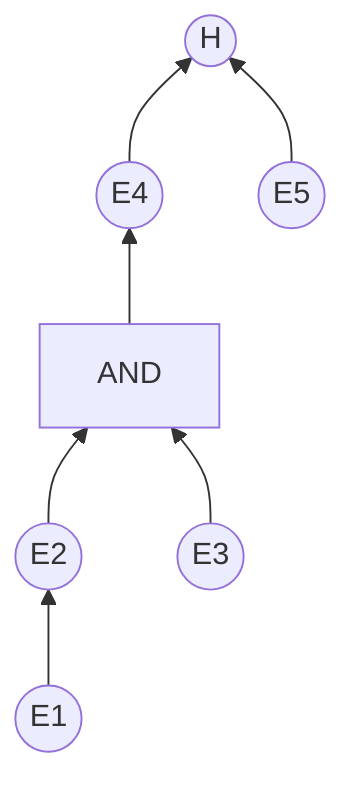

[TOC]


## 1999

1.近年来，对人类智能的理解上形成了两种不同的观点，一种观点称做（ **符号**） 主义，另一种观点，即（**仿生学**）的观点，称做（**联结**）主义。
2，常用的知识表示方法有**逻辑表示法**、**（框架表示法），（语义网络表示法），（面向对象表示法），（产生式表示法）**

## 2000

5，在诞生初期，人工智能被定义为这样一个计算机科学的分支: 它是研究（**使计算机来完成能表现出人类智能的任务的学科**）。人工智能程序与通常意义下的程序比较它具有以下四个特点: （**以符号表示的知识而不是数值数据为研究对象**），（**采用的是启发式推理方法，而不是常规的算法**），（**控制结构与领域知识是分离的**），（**允许出现不正确的解答**）

6.用反演（refutation）归结证明定理，证明过程是这样结束的。若 （**归结出现空子句NIL**），则定理得证；若（**归结不出现空子句NIL**），则证明失败。
7，在语义网络中，为了进行节点（结点，node）间节点属性的继承推理，规定了两个约定俗成的链（弧，arc），命名为 （**AKO (a kind of )**） 和 （**ISA (is a)**），用来标明类与子类、类与个体之间的关系。
8，产生式规则与蕴涵规则的区别在于: 产生式规则（**可以用于不精确推理，本身没有真值**），而蕴涵规则（**只能用于精确推理，本身有真值**）。

10.主观Bayes推理中，规则E -> H的不确定性是以似然比 LS 和 LN 描述的。LS表示了规则成立的（**充分**）性; LN表示了规则成立的（**必要**）性

四、对结论做假设 H，有证据 E1 和 E2，规则 R1 和 R2。(10分)  P92

R1: E1-->H,LS=20,LN=1
R2: E2-->H,LS=300,LN=1

已知 H 的先验概率 P(H)=0.03。若证据 E1 和 E2 依次出现，按主观Bayes推理，求H在此条件下的概率P(H/E1，E2)。
(注意:每步应列出计算式，计算结果可取近似值。)

P(H/E1) = LS1 x P(H)  / ((LS1 - 1) x P(H) + 1) = 20 x 0.03 / (19 x 0.03 + 1) = 0.382

P(H/E1, E2) = LS2 x PH(H/E1) / ((LS2 - 1) x P(H/E1) + 1)  = 300 x 0.382 / (300 - 1) x 0.382 + 1 = 0.9946

## 2001

(4) 主观Bayes推理中，规则E –> H，其 LS=LN=1，这意味着（A）。

​	A. E对H没有影响  B. E支持H C. ~E支持H

(6) 反演归结的支持集策略规定:参加归结的子句应这样选取：（**至少就有一个子句是由目标公式的否定所得到的子句或是它们的后裔**），而其归结式应并入（**子句集**）内。

(8) 以反演归结证明子句集S不可满足的过程中，当前归结式是（**包含一个空子句**）或（**包含一个非空子句并且该子句已经在前面的步骤中出现过**）则可删除。

(9) 语义网络是 （**通过概念及语主义关系来**）表示的[节点1，有向弧，节点2]三元式联结而成的。其节点表示（**概念或实体**），其弧表示（**概念或实体之间的关系**）。

(10)PROSPECTOR系统中的规则，由专家指定其L S、LN的值，由似然比定义知:LS、LN与0(零)比较应L S、LN皆 （**大于**）0，并且，若指定 LS>1，则 LN 应指定（**小于1的正数**）：反之亦然。


## 2003

1. **阐明不确定推理和基于 Case 推理的含义，并给出建立一种不确定推理方法要解决的主要问题。**

   答：不确定推理的基本问题
   1) 不确定性的表示: 知识、证据
   2) 不确定性的匹配
   3) 组合证据不确定性的计算
   4)不确定性的更新
   5) 不确定性结论的合成

## 2004

**1、对基于案例 (case) 的推理系统与基于规则的专家系统做一个比较(2004)**

- RBR和CBR的比较
  - 基于规则的推理(RBR)系统的难点
  - 知识获取是瓶颈问题:
  - 应用领域是固定的;
  - 推理链不能太长;
  - 知识库的维护很困难
  - 不能处理没有规则的领域问题
  - 没有学习能力
  - 结果不易于解释和接受
- CBR系统的优势
  - 知识的获取非常容易;
  - 具有学习能力;
  - 可以处理更多领域的问题;
  - 推理过程相对简单;
  - 结果更易于解释和接受

## 2005

三、问答或计算题(共 10 分，每小题 5分) (2006, 2007, 2008)
**1、若案例(case)不够充足，而有足够的规则(知识)，试问如何构建一个包含有基于案例推理和基于规则推理的推理系统，以使推理效率提高而且总能求得问题的解**

知识参考:
传统的专家系统一般采用的是基于规则的推理(Rule-based Resoning)，它是通过前因后果链（如规则链）演绎出结论的过程。对于易于表示成启发式规则的问题来说 RBR 方法比较合适，如分类问题和诊断问题。但是当人们遇到一个新的问题的时候，一般先是回忆，从记忆中找到一个与新的问题相似的案例，然后把该案例的有关信息和知识复用到新问题的求解之中。这种问题求解策略成为基于范例的推理 CBR。

CBR 和 RBR 是不同的，在 CBR 中求解一个问题的结论不是通过链式推理产生，而是从记忆里或范例库里找到与当前问题最相关的范例。然后对该范例做必要的改动以适应当前的问题。因此，CBR 通过联想从过去的经验出发，把过去的案例和当前面临的问题相比较做出决策的过程。问题的解答来自于过去的经验而不是规则这些经验是以案例方式存储的。
CBR 的主要优点有:
1) 比单纯的 RBR 更接近与人类决策过程，是一种自然的方法

2) 范例库比知识库容易构造，并且易于维护

3) CBR 比 RBR 有更快的执行速度。RBR 是一种链式推理，简单的推理可能触发多条规则，而且推理链环的检测更是费时。CBR 不同，其推理只是涉及与当前问题有关的若干范例，评价修改等只用围绕有限的范例进行。

4) 由于学习能力，CBR 可以将新问题的解决加入到范例库中，从而使得系统的经验不断丰富。

一般认为，CBR 适合缺乏完备和健全的理论，但又可获取丰富经验的领域，而 RBR 则适合于对领域有充分的认识，能以完备和健全的形式表示领域理论的场合。


来自GPT：一个包含基于案例推理和基于规则推理的推理系统可以如下构建：

首先，使用规则推理引擎处理给定的问题。如果规则推理引擎无法得到准确的解决方案，那么可以使用案例推理。

其次，在进行基于案例推理的推理过程中，首先需要将所有可用的案例归类，并根据案例与当前问题的相似性进行排序。此外，需要定义一个距离度量以评估两个案例之间的相似度。

接着，将最相似的案例与当前问题进行匹配，并将之前解决类似问题的解决方案应用到当前问题中。如果该解决方案不足以解决当前问题，可以尝试组合两个或更多类似案例的解决方案。

最后，如果基于案例推理的推理过程仍然无法得到准确的解决方案，则可以返回使用规则推理引擎的推理过程。

在使用混合推理方法时，需要注意选择合适的规则和案例，以确保系统在推理效率和准确性方面都能表现得很好。此外，对于具体问题的解决，还需要不断扩充和更新已有的规则和案例库，以提高系统的推理能力。


## 2006

二、证明题(共8 分)
**试用归结法证明，对任意的集合 $S$ 和 $T$，必有 $S \cap T \sube S$，（提示:需将交集 $\cap$、包含关系 $\sube$ 的定义，用逻辑式表达并作为证明的条件）**

证明：设集合 $S\cap T = R$

$R(x)$ 表示元素 $x$ 属于集合 $R$

$S(x)$ 表示元素 $x$ 属于集合 $S$

$T(x)$ 表示元素 $x$ 属于集合 $T$

${\rm Include}(A, B)$ 表示集合 $A$ 包含于集合 $B$ 包含

关系的逻辑表达式为

$(\forall A)(\forall B)(\forall x)(A(x) \rightarrow B(x)) \rightarrow {\rm Include}(A,B)$ 

R是集合S和T的交集的逻辑表达式为

$(\forall x)S(x) \and T(x) \leftrightarrow R(x)$

目标表达式为

$(\forall x)(S(x) \and T(x) \leftrightarrow R(x)) \rightarrow {\rm Include}(R,S)$

将事实公式和取反的目标公式分别标准化为子句，再收集进子句集 S:

(1) $A(x) \or {\rm Include}(A, B)$

(2) $\neg B(x) \or {\rm Include}(A,B)$

(3) $\neg S(x)$

(4) $\neg T(x)$

(5) $R(x)$

(6) $S(x)$

(7) $T(x)$

(8) $\neg R(x)$

(9) $\neg {\rm Include}(R,S)$

(10) $R(x)$                    (1) 与 (9) 归结 $\{A/R, B/S\}$

(11) NIL						(10)与(8) 归结


来自GPT

我们可以使用归结法证明 $S\cap T\subseteq S$。

首先，根据交集的定义，对于任意元素 $x$，如果 $x\in S\cap T$，则 $x\in S$ 且 $x\in T$。这可以用以下逻辑式表示：

$$ (x\in S\cap T)\rightarrow (x\in S) \wedge (x\in T) $$

同时，包含关系的定义表明，如果 $x$ 在两个集合 $A$ 和 $B$ 中，且 $A\subseteq B$，那么 $x$ 必定在 $B$ 中，即：

$$ (x\in A) \wedge (A\subseteq B) \rightarrow (x\in B) $$

然后，我们可以通过对两个逻辑式的归结来证明 $S\cap T\subseteq S$。具体的，假设存在一个 $y$，它既属于 $S\cap T$，又不属于 $S$：

$$ (y\in S\cap T) \wedge (y\not\in S) $$

由于 $y\not\in S$，我们可以进一步写成:

$$ \neg (y\in S) $$

将 $y\in S\cap T$ 代入式子，我们得到 $y \in S$ 且 $y\in T$，这与 $\neg(y\in S)$ 相矛盾，因此必须不存在这样的 $y$。因此，我们证明了任意集合 $S$ 和 $T$，均有 $S\cap T\subseteq S$，证毕。

三、问答题(共12 分，每小题4 分)
**1.试说明使用神经网络识别汉字的主要步骤**
	解析：由于汉字数量庞大，属于超多类的分类问题，这时人工神经网络的规模会很大，结构也很复杂，目前很难达到实用，如果对于一个或少量汉字的识别则比较容易。
这时可以将 ANN 作为单纯的分类器（不含特征提取，选择），一般是将这个汉字的图像点阵直接作为神经网络的输入，如网络输入层可以有 16*16 个神经元，另外有许多隐单元，只有一个输出单元，输入若是该汉字则输出 1，否则为 0.
为了训练该网络需要提供该汉字的点阵图像，神经网络所“提取”的该汉字的特征储存在神经网络中各个神经元的连接之中。不断训练，直到网络能对该汉字正确识别为止。

下面是自己总结：

1. 数据预处理：将需要识别的汉字进行二值化处理，即将图像转为黑白二值图片；同时对处理后的汉字图片进行去噪、简化和提取特征等操作。
2. 神经网络模型设计：选择合适的神经网络模型，通常是卷积神经网络（CNN）或循环神经网络（RNN）等，根据输入和输出特征的差异，设计合适的网络层数和节点数等参数，并对网络进行训练。
3. 神经网络训练：将预处理过的汉字图片输入到神经网络中，从而不断进行权重、偏置等的调整，逐步提高神经网络分类汉字的准确性。训练过程中要注意收集准确的训练集和测试集，同时进行交叉验证等操作，评测网络的性能表现。

**3.试说明数据挖掘技术的含义，并列举出几种常用的数据挖掘方法。**

​	解析:数据挖掘是从大量的不完全的，有噪声的模糊的，随机的数据中，提取隐含在其中的，人们事先不知道的但又是潜在有用的信息和知识过程。它通常采用机器自动识别的方式，不需要更多的人工干预。可以说数据挖掘就是知识发现技术在数据库领域的应用，其在一个已知状态的数据集上通过设置一定的学习算法，发掘出数据间隐含的一些内在的规律，即获取所谓的知识。常用的数据挖掘方法主要包括决策树、相关规则、神经元网络、遗传算法，以及可视化、OLAP 联机分析处理等。另外也采用了传统的统计方法。

**4、试比较专家系统和基于案例 (case) 推理系统的结构、推理机制。**

- RBR和CBR的比较
  - 基于规则的推理(RBR)系统的难点
  - 知识获取是瓶颈问题:
  - 应用领域是固定的;
  - 推理链不能太长;
  - 知识库的维护很困难
  - 不能处理没有规则的领域问题
  - 没有学习能力
  - 结果不易于解释和接受
- CBR系统的优势
  - 知识的获取非常容易;
  - 具有学习能力;
  - 可以处理更多领域的问题;
  - 推理过程相对简单;
  - 结果更易于解释和接受

## 2007

三、问答题

2. **自然语言理解的含义是什么？简述对自然语言表达的文本做理解的过程。**

   答：自然语言理解就是研究如何让计算机理解人类语言的一个研究领域。

   自然语言的分析和理解过程是一个层次化的过程。过程有 3 个层次：词法分析、句法分析和语义分析。

   - 词法分析：主要目的是找出词汇的各个词素，从中获得语言学信息。
   - 句法分析：对句子或短语的结构进行分析，以确定构成句子的各个词、短语之间的相互关系以及各自在句子中的作用。
   - 语义分析：通过分析找出词义、结构意义及其结合意义，从而确定语言所表达的真正含义或概念。

3. **指出实例学习和基于解释学习的区别。**

   答：**实例学习**是通过从环境中取得若干与某概念有关的例子，经**归纳**得出**一般性概念**的一种方法。

   **解释学习**是一种**演绎学习**方法，这种方法通过运用相关的**领域知识**，对当前提供的**单个问题求解实例**进行分析，构造出求解过程的因果**解释结构**，并通过对该解释结构**一般化**处理获取**相应知识**。


## 2008年

### 网络

**1．自治系统 AS（autonomous system）** 

​	答：指具有单一管理权限（或独立行政单位管辖下）的网络和路由器；采用AS内部网关协议（域内路由选择协议）确定分组在AS内的路由；采用外部网关协议（域间路由选择协议）处理分组在AS之间的路由。

**2．慢启动（slow start）**

​	答：TCP进行拥塞控制的一种方法；使拥塞窗口在初始时大小为1（1个最大报文段长度），每收到一个ACK应答（对新报文段的确认），拥塞窗口增1，逐步增加拥塞窗口大小。

**1．试说明以太网规定的最短帧长是多少？为什么要限制最短帧长？**

​	答：太网定义最短帧长为64字节。最短长度的限制与以太网MAC层的CSMA/CD 协议有关。以太网在发送数据帧时能够检测到冲突并停止发送。如果帧长度过短，在检测到冲突之前帧已经发送完毕，则协议无法进行有效冲突检测。

**2．试说明 TCP 协议是如何提供端到端可靠的传输服务的？** 

​	答：TCP协议是面向连接的协议；可靠建立连接（也可答三次握手建立连接）和终止连接；采用滑动窗口协议进行流量控制和差错控制。

### 人工智能

2.本体(Ontology)是一种（ C ）

​	A.推理方法，B.产生式系统的另一种形式， C.概念和概念间关系的表示方法

3.从理论上讲没有当今计算机不能计算求解的问题 （ B ）

​	A.是，  B.不是 ， C.尚无定论

**1. 近年来人工智能学科的研究热点，主要在哪几个方面?**

​	答：Agent 理论与应用，数据挖掘，统计机器学习。

**2.说明 Agent (智能体或主体)概念，以及多Agent 系统的主要研究内容**

​	答：Agent 是某个环境下的计算机系统 ，具有在该环境下自动行动来实现目标的能力（自主性）。还具有与其他 Agent 交互共同完成问题求解的能力（社会性）。

​	多 Agent 系统主要研究 Agent 和 Agent 群体的模型，以及多 Agent 合作求解的机理。

**3.说明一种归结方法是完备的含义，并举出一种不完备的归结策略。**

​	答：一种归结方法是完备的，指的是如果定理成立，使用这种归结方法必会给出证明。如单元归结策略就是不完备的。

## 2009

1. **给出近年来机器学习研究的趋势。**

   每年都可能不太一样，按当时的趋势来写

2. **说明框架知识表示方法的组成，并以一辆汽车为例，用框架知识表示方法表示出这辆车的主要信息。**
  


答：

框架名：<汽车>
   颜色：
   年份：
   品牌：
   座位数：
   能源类型：
   发动机：<发动机框架>
   变速箱：<变速箱框架>

   

3. **以建造医疗诊断专家系统为例，给出产生式表示的专家系统的结构图和推理机制**

   ```mermaid
   flowchart TD
   A["人机接口"] <--> B["知识获取机构"]
   A <--> C["推理机"]
   A <--> D["解释器"]
   
   B <--> E["知识库及其原理系统"]
   C <--> E
   
   C <--> F["综合数据库及其管理系统"]
   D <--> F
   ```

   

4. **阐明符号表示机制和连接（神经网）机制实现智能的主要区别。**

   答：

   - 符号主义
     - 逻辑主义或计算机学派。认为人类的智能的**基本单元**是**符号**，认知过程就是符号表示 下的**符号计算**，从而思维就是**符号计算**。其原理主要为物理符号系统假设和有限合理性原理。
   - 联结主义
     - 又称仿生学派。认为人类的智能的基本单元是**神经元**，认知过程是由神经元构成的网络的**信息传递**，这种传递是并行分类进行的。基原理主要是神经网络间的连接机制与学习算法。

## 2010

三、问答题(每小题4分，共 12 分)
**1.给出常使用的描述Agent 的逻辑模型，并说明使用这种模型带来的问题。**

​	答：常使用的描述 Agent 的逻辑模型有：思考型 Agent。

它是以传统的符号AI的方法来实现 Agent 的表示和推理，它结构僵硬，无法对环境的变化做出快速响应，而且执行效率相对较低。

**2.使用支持向量机算法 (SVM) 求解问题的关键点。**

​	答：为了使这个分类超平面更具鲁棒性，我们会去找最佳超平面，以最大间隔把两类样本分开的超平面，也称之为最大间隔超平面。

- 两类样本分别分割在该超平面的两侧；
- 两侧距离超平面最近的样本点到超平面的距离被最大化了。

**3.列举出常用的几种人工智能优化算法。**

​	答：遗传算法，免疫算法，蚁群算法，粒子群算法，模拟退火算法，神经网络算法

4. **以 MYCIN 专家系统为例，说明建立一种不确定推理机制的要点。**

## 2011

**2.基于案例(case)的推理是归结推理方法的一种特例吗? （ B ）**
	A.是 B.不是
**3.脚本(script)方法是一种结构化的推理方法吗?（ B ）**

​	A.是 B.不是
**4.不确定性推理是一种概率意义下的推理方法吗?（ B ）**

​	A.是 B.不是

二、证明题(共10分)

**使用单元(unit)归结策略的归结法 (resolution)证明**
**$A1 \and A2 \and A3 \rightarrow B$**
**其中**
**$A1=(\forall x)((C(x) \and \neg D(x)) \rightarrow (\exist y)(G(x, y) \and E(y)))$**

**$A2=(\exist x)((C(x) \and F(x))\and (\forall y)(G(x, y)\rightarrow F(y)))$**

**$A3=\neg(\exist y)(D (x) \and F(x))$**

**$B=(\exist x) (E(x) \and F(x))$**

证明：要证明 $A1 \and A2 \and A3 \rightarrow B$，则转化为 $A1 \and A2 \and A3 \and \neg B$ 是否出现空子句

（1）把公式化为子句：
$$
\begin{aligned}
A1&=(\forall x)((C(x) \and \neg D(x)) \rightarrow (\exist y)(G(x, y) \and E(y))) \\
&= (\forall x)(\neg(C(x) \and \neg D(x)) \or (\exist y)(G(x, y) \and E(y))) \\
&= (\forall x)((\neg C(x) \or D(x)) \or (\exist y)(G(x, y) \and E(y))) \\
&= (\forall x)((\neg C(x) \or D(x)) \or (G(x, f(x)) \and E(f(x)))) \\
&= (\forall x)((\neg C(x) \or D(x) \or G(x, f(x))) \and (\neg C(x) \or D(x) \or E(f(x)))) \\
\end{aligned} \nonumber
$$

$$
\begin{aligned}
A2&=(\exist x)((C(x) \and F(x))\and (\forall y)(G(x, y)\rightarrow F(y))) \\
&=(\exist x)((C(x) \and F(x))\and (\forall y)(\neg G(x, y)\or F(y))) \\
&=(\exist z)(\forall y)((C(z) \and F(z))\and (\neg G(z, y)\or F(y)))
\end{aligned}
$$

$$
\begin{aligned}
A3&=\neg(\exist y)(D (x) \and F(x)) \\
&=(\forall y) (\neg D(x) \or \neg F(x))
\end{aligned}
$$

$$
\begin{aligned}
\neg B &= \neg(\exist x) (E(x) \and F(x)) \\
&=(\forall x)(\neg E(x) \or \neg F(x))
\end{aligned}
$$

$$
\begin{aligned}
&(1) (\neg C(x) \or D(x) \or G(x, f(x))) \\
&(2) (\neg C(x) \or D(x) \or E(f(x))) \\
&(3) C(z) \\
&(4) F(z)) \\
&(5) \neg G(z, y)\or F(y) \\
&(6) \neg D(x) \or \neg F(x) \\
&(7) \neg E(x) \or \neg F(x) \\
&(8) \neg E(z) &(4)(7)归结 \\
&(9) \neg D(z) &(4)(6)归结 \\
&(10) D(z) \or E(f(z)) &(2)(3)归结 \\
&(11) E(a) &(9)(10)归结 \\
&(12) {\rm NIL} &(8)(11)归结
\end{aligned}
$$

三、问答题 (每小题4分，共12分)
**1.说明数据挖掘的含义，并列举出几种数据挖掘方法**

​	解析:数据挖掘是从大量的不完全的，有噪声的模糊的，随机的数据中，提取隐含在其中的，人们事先不知道的但又是潜在有用的信息和知识过程。它通常采用机器自动识别的方式，不需要更多的人工干预。可以说数据挖掘就是知识发现技术在数据库领域的应用，其在一个已知状态的数据集上通过设置一定的学习算法，发掘出数据间隐含的一些内在的规律，即获取所谓的知识。常用的数据挖掘方法主要包括决策树、相关规则、神经元网络、遗传算法，以及可视化、OLAP 联机分析处理等。另外也采用了传统的统计方法。

**2.说明框架 (frame)表示的含义，并给出框架的一般表示形式。**

​	答：框架通常由描述事物各反面的若干个槽组成，每个槽又拥有若干个侧面，每个侧面又有若干个值。


**3.说明如何用基于案例的推理来构建一个医疗诊断系统。**

​	答：4R，Retrieve，Reuse，Revised，Retain，即相似案例检索、案例重用、案例的修改和调整、案例学习四个步骤的循环。

​	(1)   根据输入案例检索最相似的过去案例，检索的结果为一个或多个案例；

  （2）根据检索出的案例与输入案例的差别，对检索出的案例的解决方案进行修改，以适应当前问题的具体特点；

  （3）尝试用检索出案例的问题解决方案解决当前问题；

  （4）根据应用情况，修改上一步问题求解方案，得到最终的问题求解方案，将当前问题的描述及最终解决方案合并成为新案例放入案例库，以备后用。


## 2012

三、问答题（每小题 4 分，共 12 分）

**1.说明在专家系统中不确定推理的含义，以及建立一种不确定推理机制，要解决哪些问题?**

​	答：不确定推理就是从具有不确定性的证据出发，运用知识（或规则）库中的不确定性的知识，最终推出具有一定程度的不确定性，但却是合理的或近乎合理的结论的思维过程。

​	要解决的问题有：不确定性的表示问题，不确定性的推理计算问题，不确实性度量问题。

**2.说明在自然语言处理中，机器理解了一段输入的“自然语言文本”的含义是什么?**

​	答：在自然语言处理中，机器理解一段输入的自然语言文本的含义是指，机器能够理解并掌握文本中所表达的语义和语法结构，包括词汇、语法、句子结构、语气、主题等，进而从文本中提取信息、解答问题、回答询问、生成新的语言文本等任务。为了实现这一过程，自然语言处理系统需要使用一系列算法和技术，包括词法分析、句法分析、语义分析等等。其中，语义分析是自然语言处理中的重要环节，其目的是从文本中推断出其中的意义，以便机器做出相应的处理和回应。

**3.近年来人工智能学科的研究热点，主要集中在哪几个方面?**

答：2012年以前，人工智能学科的研究热点主要集中在以下几个方面：

1. 专家系统： 专家系统是一种基于知识库的人工智能系统，它可以通过规则推理和知识表示达到与专家相同的水平进行决策和诊断。在20世纪80年代，专家系统研究是人工智能的重要热点之一。

2. 机器学习： 机器学习是指计算机通过学习数据和模式来自我完善和提高的过程。在20世纪90年代，支持向量机（SVM）和朴素贝叶斯等机器学习方法被广泛应用于计算机视觉和自然语言处理等领域。

3. 模式识别： 模式识别研究的是从复杂数据中自动提取潜在的有用结构和特征的方法。它在语音识别、图像识别和生物信息学等领域得到了广泛应用。

4. 自然语言处理： 自然语言处理研究的是如何让计算机理解和处理人类的自然语言。在20世纪80年代至90年代中期，自然语言处理技术达到了繁荣发展的时期。

5. 计算机视觉： 计算机视觉研究的是如何让计算机理解图像和视频。在20世纪80年代和90年代，计算机视觉技术取得了很多进展和突破，例如人脸识别、目标跟踪等领域。


## 2013

三、问答题(每小题4分，共12分)

**1.给出建造基于案例(case)推理系统的主要步骤。**

答：4R，Retrieve，Reuse，Revised，Retain，即相似案例检索、案例重用、案例的修改和调整、案例学习四个步骤的循环。

​	(1)   根据输入案例检索最相似的过去案例，检索的结果为一个或多个案例；

  （2）根据检索出的案例与输入案例的差别，对检索出的案例的解决方案进行修改，以适应当前问题的具体特点；

  （3）尝试用检索出案例的问题解决方案解决当前问题；

  （4）根据应用情况，修改上一步问题求解方案，得到最终的问题求解方案，将当前问题的描述及最终解决方案合并成为新案例放入案例库，以备后用。


**2.说明多Agent系统主要研究内容**

​	答：

- 联合负责模型
  - 旨在制定实现多 Agent 协同合作的要求准则

- 多 Agent 协商
  - 指系统中各个 Agent 间实现协同、协作以及实现冲突消解的一种策略
- 多 Agent 规划
  - 规划是连接精神状态与动作执行之间的桥梁。

**3.说明当前机器学习领域的主要研究方面。**

答：不确定推理就是从具有不确定性的证据出发，运用知识（或规则）库中的不确定性的知识，最终推出具有一定程度的不确定性，但却是合理的或近乎合理的结论的思维过程。

​	要解决的问题有：不确定性的表示问题，不确定性的推理计算问题，不确实性度量问题。

**2.说明在自然语言处理中，机器理解了一段输入的“自然语言文本”的含义是什么?**

​	答：在自然语言处理中，机器理解一段输入的自然语言文本的含义是指，机器能够理解并掌握文本中所表达的语义和语法结构，包括词汇、语法、句子结构、语气、主题等，进而从文本中提取信息、解答问题、回答询问、生成新的语言文本等任务。为了实现这一过程，自然语言处理系统需要使用一系列算法和技术，包括词法分析、句法分析、语义分析等等。其中，语义分析是自然语言处理中的重要环节，其目的是从文本中推断出其中的意义，以便机器做出相应的处理和回应。

**3.近年来人工智能学科的研究热点，主要集中在哪几个方面?**

​	答：2012年以前，人工智能学科的研究热点主要集中在以下几个方面：

1. 专家系统： 专家系统是一种基于知识库的人工智能系统，它可以通过规则推理和知识表示达到与专家相同的水平进行决策和诊断。在20世纪80年代，专家系统研究是人工智能的重要热点之一。

2. 机器学习： 机器学习是指计算机通过学习数据和模式来自我完善和提高的过程。在20世纪90年代，支持向量机（SVM）和朴素贝叶斯等机器学习方法被广泛应用于计算机视觉和自然语言处理等领域。

3. 模式识别： 模式识别研究的是从复杂数据中自动提取潜在的有用结构和特征的方法。它在语音识别、图像识别和生物信息学等领域得到了广泛应用。

4. 自然语言处理： 自然语言处理研究的是如何让计算机理解和处理人类的自然语言。在20世纪80年代至90年代中期，自然语言处理技术达到了繁荣发展的时期。

5. 计算机视觉： 计算机视觉研究的是如何让计算机理解图像和视频。在20世纪80年代和90年代，计算机视觉技术取得了很多进展和突破，例如人脸识别、目标跟踪等领域。


## 2014

三、问答题(每小题4分，共12 分)
**1.对一类问题求解来说，若有部分案例 (case)，而有较多的推理规则(知识)，试问如何建造一个由基于案例推理和规则推理相结合的求解系统，以使推理效率高又能求得问题的解。**

​	答：**基于规则的推理（RBR）系统的难点**：知识获取是瓶颈问题；应用领域是固定的；推理链不能太长；知识库的维护很困难；不能处理没有规则的领域问题；没有学习能力；结果不易于解释和接受。

**CBR系统的优势**：知识的获取非常容易；具有学习能力；可以处理更多领域的问题推理过程相对简单；结果更易于解释和接受


**方式二:嵌入**
两种嵌入方式

- 1)在CBR系统中，引入检索案例或者修正案例的规则，按照规则进行检索或修正。
- 2)在设计RBR系统中规则库时，对某些难以规则化的知识，采用案例的表示形式；相应的推理系统中嵌入基于案例的推理机制。

**2.已知北京市地图以及地图中任意两点A和B 的最短路径算法，试给出一种计算A和B最短路径的启发式算法。**

​	答：

- (1) **地图映射成为状态空间图**

  - 道路的路口为节点，把节点依次相连就构成了可用于搜索的图

- (2) **设计估计函数 $h(n)$，**为平面中的两点的**欧氏距离**

- (3) **写出图搜索方法的过程**

  - 定义数据结构

    - **Open表**用于存放没有进行扩展节点，**未扩展节点**
    - **Closed表**用于存放已经扩展的节点，已扩展节点

  - 表基本过程:

    - 把 $A$ 作为当前节点开始搜索

    - 如果当前节点是目标节点 $B$ 则结束，否则

    - 扩展当前节点，并将扩展的节点放在Open表中

    - 对扩展的节点计算估计函数，并按距离由小到大对 Open 表进行排序

    - 从Open表中取出第一个节点作为当前节点，重复搜索

      

**3.给出分类问题的描述，进而说明用于分类的有监督机器学习方法与无监督机器学习方法。**

​	答：分类问题的描述：给定一组数据点，每个数据点具有一组特征，同时被分配到一个离散的类别中。例如，我们可以将一些水果的特征（例如重量、颜色、形状等）和它们的类别（例如橙子、苹果、香蕉等）组合成一组数据点，任务就是根据这些特征将每个水果归类。分类问题是一种有监督学习问题，因为每个数据点都有一个已知的类别。

​	有监督机器学习方法是指机器学习从输入输出对中学习一个映射函数。即，给定一组已知特征和其对应的类别标签，训练数据集中就有了对于每个特征向量的标签信息。学习后的模型可以将新的特征向量映射到它所属的类别。有监督机器学习方法包括逻辑回归、决策树、朴素贝叶斯、支持向量机等。

​	无监督机器学习方法是指机器学习从无类别标签的数据中学习模型。无监督学习任务通常涉及到将数据聚类成不同的组别。例如，给定一个大型的用户数据集，我们可能需要将用户分类到不同的群体中，以便掌握不同群体的行为和兴趣。无监督机器学习方法包括聚类，PCA和关联规则等算法。无监督学习方法的优势是在不知道类别标签的情况下找到数据的内在结构，从而可以为后续的分类或监督学习提供帮助。


## 2019

三、简答题 (每题4分，共12分)

**1.近几年机器学习的发展阶段**

​	答：归纳学习期：20世纪80年代以来，被研究最多、应用最广的是“从样例中学习”，即从训练样例中归纳出学习结果，也就是广义的归纳学习，它涵盖了监督学习和无监督学习等。“从样例中学习”的一大主流是符号主义学习，其代表包括决策树和基于逻辑的学习。典型的决策树学习以信息论为基础，以信息熵的最小化为目标，直接模拟了人类对概念进行判定的树形流程；20世纪90年代中期，统计学习出现并迅速占据主流舞台，代表性技术是支持向量机（SVM）以及更一般的“核方法”。21世纪初，连接主义学习又卷土重来，掀起了以“深度学习”为名的热潮。

**2.如何建立一个基于案例的法院审判系统**

答：建立一个基于案例的法院审判系统是一项复杂的任务，并且需要考虑许多不同的因素。以下是可能需要考虑的一些步骤：

1. 数据收集：首先，在建立一个基于案例的法院审判系统之前，需要收集大量的法律案例和相关文本数据。这些数据可以包括法律文书、案件文件、诉讼文件、法律评论以及其他文献等。

2. 数据清理：在收集数据后，需要进行数据清理、标准化和预处理。这涉及删除不相关的信息、从数据中提取必要的元数据（例如被告人姓名、罪名、判决结果等）以及将数据格式化为机器可读的形式。

3. 特征提取：在进行数据清理和预处理之后，需要从数据中提取特征。特征提取是将案例转变为可用于模型训练的数学向量的过程。这些特征可以包括案例中使用的法律条文、案情描述、法官评注以及案件中涉及的证据等。

4. 相似性度量：相似度量是一个重要的步骤，它用于计算案例之间的相似性。在案例库中，相似性度量用于查找最相似的案例并提供基于历史案例的建议。相似度量可以采用不同的方法，例如余弦相似度、欧氏距离、曼哈顿距离等。

5. 建立模型：基于数据和特征提取以及相似度量，可以建立机器学习模型。这可以包括分类、回归或聚类等算法。建立模型的目的是为了根据历史案例的特点和结果预测未来案件的结果。

6. 验证和调整：建立好模型后，需要对其进行验证和调整。这包括在测试数据集上对模型的性能进行评估，并根据结果对其进行调整。

7. 集成到系统中：最后，需要将基于案例的法院审判系统集成到实际的系统中，并为用户提供直观易用的界面。

需要注意的是，建立一个基于案例的法院审判系统需要大量精心的设计和实践，具体的步骤和细节可能因情况而异。

**3.如何用决策树进行二元分类**

​	答：（1）绘制决策树。从左到右绘制决策树的过程就是决策问题的再分析过程。（2）从右到左计算每个方案的期望值，并将结果写在对应方案节点的顶部。（3）通过比较各方案的期望值，进行剪枝优化。要使用“=”分区就要放弃支路上的备选方案，这取决于数据量和样本数。不同的样本和特征数据适用于不同的算法。像神经网络这样的深度学习算法需要训练大量的数据集来建立更好的预测模型。许多大型互联网公司更喜欢深度学习算法，因为他们获得的用户数据是数以亿计的海量数据，这更适合于卷积神经网络等深度学习算法。如果样本数量较少，则更适合使用SVM、决策树和其他机器学习算法。如果你有一个大的数据集，你可以考虑使用卷积神经网络和其他深度学习算法。

​	来自GPT：决策树是一种基于树形结构的分类算法，它能自动建立一棵分类树来进行分类。当应用于二元分类时，可以按照以下步骤进行操作：

1. 收集数据集：数据集除了包含特征属性外，还需要包含每个数据点的类别标签。
2. 选择最佳特征：通过计算各特征的信息增益（基尼系数、误差减少等），选择一个最佳的特征作为当前节点的分类依据。
3. 划分数据集：根据选择的最佳特征，将数据集划分成两个子集，分别对应于当前节点的两种分类结果。
4. 递归生成子树：对于每个子集，递归生成子树，直到所有的叶子节点都属于同一类别或者当前节点的特征属性已经全部被用完。
5. 构建决策树：生成完整的分类树后，可以将新的数据点输入到决策树中，通过逐层分类的方式，最终确定新数据点的分类结果。

需要注意的是，为了避免过拟合，需要对生成的决策树进行剪枝处理。常用的剪枝方法有预剪枝和后剪枝，常见的后剪枝方法包括交叉验证剪枝和代价复杂度剪枝等。


## 2022

三、简答题(每小题4分，共12分)
**1.说明使用支持向量机求解二分类问题的原理**

​	答：支持向量机是一类按监督学习方式对数据进行二分类的广义线性分类器，基本模型是定义在特征空间上的间隔最大的线性分类器。其基本思想是求解能够正确划分训练数据集并且几何间隔最大的分离超平面。使用核技巧，把输入的特征空间映射到到一个新的空间。对线性不可分的样本，通过松弛变量和核函数技术来实现，对离群点进行惩罚调整目标函数 使其值最小，实现分类。

​	来自GPT：支持向量机（Support Vector Machines，简称SVM）是一种常用的二分类模型。其原理基于将不同类别的数据点通过一个超平面分隔开来，同时追求分类结果的最大间隔。具体的求解过程可以如下：

1. 数据预处理：将样本数据处理为向量形式，并进行标准化处理。
2. 确定超平面：在样本数据空间中寻找一个超平面，使得各类别样本点到超平面的距离最大，即求解一个最优化问题。如果样本间线性可分，则可用硬间隔最大化求解，如果线性不可分，则采用软间隔最大化求解。
3. 求解支持向量：确定最终超平面后，找出距离超平面最近的样本点，它们为支持向量。
4. 决策函数：通过求解分类超平面，构建分类决策函数，对于新数据点，通过决策函数进行分类。

SVM有很好的泛化性能，在实际应用中得到广泛应用。

**2.解释什么是分支界限法。**

​	答：

1. 以**广度优先**或以**最小耗费（最大效益）优先**的方式搜索问题的解空间树
2. 分支限界法中，每一个活结点**只有一次机会**成为扩展结点，活结点一旦成为扩展结点，就一次性产生其所有儿子结点，其中导致**不可行解**或导致**非最优解**的**儿子结点被舍弃**，其余**儿子结点**被加入活结点表中
3. 然后从活结点表中取下一结点成为当前扩展结点
4. 重复上述结点扩展过程，直至到找到所需的解或活结点表为空时为止
5. 两种觉的分支限界法：队列式分支限界法（FIFO）与优先队列分支限界法（代价最小或效益最大）

**扩展**：分支限界法与回溯的区别

- **求解目标不同**

  - **回溯法**的求解目标是找出解空间树中满足约束条件的**所有解**
  - **分支限界法**的求解目标则是尽快找出满足约束条件的**一个解**，或是在满足约束条件的解中找出在某种意义下的最优解
  - **分支限界法**通常用于解决**离散值**的最优化问题

- **搜索方式不同**

  - **回溯法**以**深度优先**的方式（**遍历结点**）搜索解空间树
  - **分支限界法**以**广度优先或最小耗费优先**的方式搜索解空间树

- **对扩展结点的扩展方式不同**

  - 分支限界法中，**每一个活结点**只有**一次机会**成为扩展结点
  - 活结点一旦成为扩展结点，就一次性产生其所有儿子结点

- **存储空间的要求不同**

  - **分支限界法**的存储空间**比回溯法大得多**，因此当内存容量有限时，**回溯法成功的可能性更大**

  [reference](https://blog.csdn.net/u010089444/article/details/74331907)

来自GPT：分支界限法是一种组合优化算法，主要用于求解离散优化问题。它的基本思想是用可行性问题的解空间来构造一棵搜索树，每个节点表示一个可行解，搜索树的叶子节点表示最优解，通过分治和剪枝操作，逐步缩小搜索空间，直到得到最优解为止。

具体来说，分支界限法的过程如下：

1. 将可行解空间划分成若干个子集（分支），每个子集对应一个节点；

2. 选择一个节点，通过搜索算法在该节点对应的子集中生成一个或多个子节点；

3. 对于每个子节点，计算上界或下界（或者二者皆有），将上下界转化为可行性问题的限制条件，将每个子节点对应到一个不重复的解；

4. 根据限制条件和目标函数的值，对某些子节点进行剪枝，即将这些节点从搜索空间中删除；

5. 不断迭代搜索，直到找到最优解。

分支界限法的主要特点是能够处理离散化问题和搜索空间非常大的问题，其又因此可以应用于很多领域，例如排产、旅行商问题、网格优化等。

**3.说明在证据理论中，用哪三个函数来描述和处理知识的不确定性**

​	答：D-S理论中，用概率分配函数，信任函数，似然函数来描述和处理知识的不确定性。

​	**信任函数**和**似然函数**是用来对命题的不确定性进行度量的。**信任函数**表示对命题**为真**的**信任程度**，而**似然函数**表示对命题**为非假**的信任程度。它们分别表示对命题信任程度的**下限和上限**。

​	引入**概率分配函数**，完全是为了定义信任函数和似然函数，以便实现对命题的不确定性的度量。也就是说信任函数和似然函数的定义是依赖于概率分配函数的，概率分配函数是对一个命题的**不确定度量**的**基础**。

这些函数是用来描述和处理知识的不确定性，从而能够在前提和结论中，进行推理和推断，进而达到优化决策的目的

### 网络

（6分）考虑一个TCP连接（Reno）使用一条带宽为100Mbps的链路发送一个大文件，这条链路是发送方和接收方之间的唯一拥塞链路。接收方的接收缓存比拥塞窗口大得多。假设端到端的传播时延为30ms。如果传输层采用TCP协议，报文段长度为1500字节。该TCP连接总是处于拥塞避免阶段，忽略慢启动。试回答：
1）这条TCP连接能取得的最大窗口大小是多少报文段？
2）这条TCP连接从丢包恢复后，再次达到最大窗口大小需要多长时间？

解：

（1） 传播时延 = 30 ms ==> RTT =  2 x 30 = 60 ms

​	设最大窗口大小为 $n$

​	$\dfrac{n \times 1500 \times 8}{100 \times 10^6} = 60 \times 10^{-3}$

​	解得 $n = 500$

（2）丢包后，cwnd 会减少为最大窗口的一半，即为 250。而且丢包后，采取的是加性增大，即每个 RTT 后 cwnd增加1，故到最大窗口500，需要经过250个RTT。

​	所以有$250 \times 60 = 15 s$


## 一些自己遇到的题

**二、证明题**

**1、请用鲁宾逊归结原理证明：**

**任何通过历史考试并中了彩票的人是快乐的。任何肯学习或幸运的人可以通过所有的考试。小张不学习但很幸运。任何人只要是幸运就能中彩。求证：小张是快乐的。**

解：

$\forall x ({\rm Pass}(x, {\rm history})) \and {\rm Win}(x, {\rm prize}) \rightarrow {\rm happy(x)}$

$\forall x \forall y ({\rm Study}(x) \or {\rm Lucky}(x)) \rightarrow {\rm Pass}(x, y))$

$\neg {\rm Study}({\rm Zhang}) \and {\rm Lucky}({\rm Zhang})$

$\forall x {\rm Lucky}(x) \rightarrow {\rm Win}(x, {\rm prize})$

结论：

${\rm happy({\rm Zhang})}$

将结论即否定 $\neg {\rm happy({\rm Zhang})}$，并加入子句集

(1) $\neg {\rm Pass}(x, {\rm history}) \or \neg {\rm Win}(x, {\rm prize}) \or{\rm happy(x)}$

(2) $\neg {\rm Study}(y) \or {\rm Pass}$

(3) $\neg {\rm Lucky}(u) \or {\rm Pass}(u, v))$

(4) $\neg {\rm Study}({\rm Zhang})$

(5) ${\rm Lucky}({\rm Zhang})$

(6) $\neg {\rm Lucky}(w) \or{\rm Win}(w, {\rm prize})$

(7) $\neg {\rm happy({\rm Zhang})}$


**三、简答题**

**1、什么是A*算法的可采纳性？**

​	答：是指对一个可求解的状态空间图，即从状态空间图的**初始节点**到**目标节点**存在路径，则该算法一定上能在有限 步内找到一条**最佳路径**，即**最优解**，并在此路径上结束，则称算法具有可采纳性。

**2、简述模式识别的基本过程**

​	答：

​	（1）信息获取

​	（2）预处理：对获取信息进行规范化等各种处理

​	（3）特征提取与选择：将识别样本构成造成便于比较、分析的描述量即特征向量

​	（4）分类器设计：由训练过程将训练样本提供的信息变为差别事物的判别函数

​	（5）分类决策：对样本特征分量按判断函数的计算结果进行分类

**3、设有如下一组推理规则**：

​	**r1: IF E1 THEN E2 (0.5)**

​	**r2: IF E2 AND E3 THEN E4 (0.6)**

​	**r3: IF E4 THEN H(0.8)**

​	**r4: IF E5 THEN H(0.9)**

​	**且已知 CF(E1)=0.5, CF(E3)=0.6, CF(E5=0.7。求CF(H)=？**

​	解：



由 r1 有
$$
CF(E2) = CF(E2, E1) \times \max\{0, CF(E1)\} = 0.5 \times 0.5 = 0.25 \nonumber
$$
由 r2 得
$$
\begin{aligned}
CF(E4) &= CF(E4, E2\and E3) \times \max\{0, CF(E2 \and E3)\} \\
&= CF(E4, E2\and E3) \times \max\{0, \min\{CF(E2), CF(E3)\}\} \\
&= 0.6 \times \max\{0, \min\{0.25, 0.6\}\} \\
&= 0.6 \times 0.25 = 0.15
\end{aligned} \nonumber
$$
由 r3 得
$$
\begin{aligned}
CF_1(H) &= CF(H, E4) \times \max\{0, CF(E4)\} \\
&= 0.8 \times 0.15 = 0.12
\end{aligned} \nonumber
$$
由 r4 得
$$
\begin{aligned}
CF_2(H) &= CF(H, E5) \times \max\{0, CF(E5)\} \\
&= 0.9 \times 0.7 = 0.63
\end{aligned} \nonumber
$$
由 $CF_1(H)、CF_2(H)$得
$$
\begin{aligned}
CF(H) &= CF_1(H) + CF_2(H) - CF_1(H) \times CF_2(H) \\
&= 0.12 + 0.63 - 0.12 \times 0.63 \\
&= 0.6744
\end{aligned} \nonumber
$$


## 选择题

**1.使用神经网来求得分类问题的解，常使用的方法首先是通过（ B ）来实现的**
 A. 增加神经网的层次
 B. 调整神经网的权值
 C. 增加神经网的输入节点

**2.非单调推理是针对（ B ）而提出的一种推理方法**
 A. 知识获取
 B. 知识不完全
 C. 规则表示不规范

**3.本体（ontology）是一种（ C ）**
 A. 实例学习算法
 B. 非单调推理方法
 C. 概念间关系的知识表示方法

**4.人工智能优化算法是为了尽力求得（ C ）解。**
 A. 全局最优
 B. 局部最优
 C. 满意

**5.框架是一种（ A ）方式。**
 A. 知识表示
 B. 推理

**6.BP网络很可能趋于（ A ）函数。**
 A. 任一连续
 B. 任一
 C. 任一离散

**7.XXX神经元构成的简单的神经网络为感知器，它不能实现（ C ）。**
 A. “与”运算
 B. “或”运算
 C. “异或”运算

**8.建立基于案例推理系统，主要花费在于（ A ）**
 A. 案例库
 B. 推理机
 C. 程序

**9.构建一个多层神经网络，可实现逼近一个任意的（ A ）。**
 A. 函数
 B. 连续函数
 C. 只有有限个间断点的连续函数

**10.支持向量机SVM是一种（ A ）算法。**
 A. 小样本下的统计机器学习
 B. 大样本下的统计机器学习
 C. 大样本下的实例机器学习

**11.非单调推理是由于处理（ B ）问题提出来的。**
 A. 逻辑矛盾
 B. 知识不完全
 C. 知识表

**12.在MYCIN专家系统中，已知证据（事实）A和B的不确定性度量分别为CF(A)=0.3和CF(B)=0.5，那么证据A^B 的不确定性度量CF(A^B)=（ B ）。**
 A. 0.5
 B. 0.3
 C. 0.15

**13.启发式搜索是使用（ C ）的一种搜索方法。**
 A. 深度优先策略
 B. 广度优先策略
 C. 经验知识

**14.建造专家系统常使用依（ C ）的推理方法。**
 A. 证据理论
 B. 概率知识
 C. 产生式规则匹配

**15.专家系统知识的规则表示是（ A ）的一类知识表示方法。**
 A. 知识库改变时，原推理程序不需改变
 B. 知识库改变时，原推理程序需随之改变
 C. 知识库改变时，原推理程序可能改变

**16.本体（ontology）是一种（ C ）**
 A. 推理方法
 B. 产生式系统的另一种表示方法
 C. 概念和概念间关系的表示方法

**17.百度、谷歌的知识问答系统，所使用的主要技术是（ C ）。**
 A. 知识推理方法
 B. 自然语言的语义理解
 C. 简单的模式匹配方法

**18.A*算法是一种（ C ）。**
 A. 深度优先搜索算法
 B. 广度优先搜索算法
 C. 可求得最优解的图搜索算法

**19.使用神经网来求解问题，常用的方法是通过（ B ）来达到。**
 A. 增减神经网络的层次
 B. 调整神经网的连接权值
 C. 增减输入节点

**20.启发式搜索是一种寻求问题（ C ）的方法。**
 A. 最优解
 B. 一般通用解
 C. 满意解

**21.基于案例（case）的推理是归结推理方法的一种特例吗？（ B ）**
 A. 是
 B. 不是

**22.脚本（script）方法是一种结构化的推理方法吗？（ B ）**
 A. 是
 B. 不是

**23.不确定性推理是一种概率意义下的推理方法吗？（ A ）**
 A. 是
 B. 不是

**24.神经网络求解问题的过程中，（ B ）陷入局部极值点。**
 A. 不可能
 B. 可能
 C. 必然

**25.提出非单调推理是由于（ B ）。**
 A. 处理逻辑矛盾
 B. 知识不完全
 C. 知识表示方法

**26.建造专家系统的主要花费在于（ B ）。**
 A. 建立推理机制
 B. 收集知识建知识库
 C. 程序设计

**27.采用单元归结策略的归结方法是（ A ）。**
 A. 不完备的
 B. 完备的
 C. 不一定

**28.使用神经网络来求得分类问题的解，实际常用的手法是通过（ B ）来达到。**
 A. 增减神经网络的层数
 B. 调整神经网络的连接权值
 C. 增减输入节点

**29.本体（ontology）是一种（ C ）**
 A. 推理方法
 B. 产生式系统的另一种形式
 C. 概念和概念间关系的表示方法

**30.从理论上讲没有当今计算机不能求解的问题（ B ）**
 A. 是
 B. 不是
 C. 尚无定论

**31.像百度、谷歌这类知识问答系统，所使用的主要技术是（ C ）。**
 A. 自然语言的语义理解方法
 B. 知识推理方法
 C. 简单的模式匹配方法

**32.建造一个多层神经网络可逼近任意的（ B ）。**
 A. 函数
 B. 连续函数
 C. 不连续函数

**33.子句C1 = ¬P∨Q∨R，C2 = P∨Q∨¬R的归结式为（ B ）。**
 A. 空子句
 B. 重言式
 C. Q

**34.支持向量机SVM是一种（ A ）算法。**
 A. 小样本下的统计学习
 B. 大样本下的统计学习
 C. 大样本下的实例学习

**35.建造一个基于案例（case）的推理系统，需研究的是给出（ C ）。**
 A. 归结推理算法
 B. 不确定推理方法
 C. 相似度计算方法

**36.近年来机器学习最活跃的研究领域是（ C ）。**
 A. 实例学习
 B. 基于解释的学习
 C. 统计机器学习

**37.建造专家系统常用的知识表示方法是（ C ）。**
 A. 逻辑法
 B. 语义网
 C. 产生式

**38.非单调推理是针对（ C ）而提出的一种推理方法。**
 A. 逻辑方法
 B. 规则表达不规范
 C. 知识不完全

**39.子句C1 = ¬P∨¬Q，C2 = P∨Q的归结式为（ B ）。**
 A. 空子句
 B. 重言式
 C. 任意子句

**40.启发式搜索是寻求问题（ C ）解的一种方法。**
 A. 最优
 B. 一般
 C. 满意

**41.单元归结法（ B ）一种完备的归结推理策略。**
 A. 是
 B. 不是

**42.启发式搜索是一种使用（ C ）的搜索方法。**
 A. 深度优先策略
 B. 宽度优先策略
 C. 经验知识
 D. 数据库查询技术

**43.子句C1 = ¬P∨Q，C2 = P∨¬Q的归结式（ A ）空子句。**
 A. 不是
 B. 是

**44.神经网络求解问题过程中，（ A ）陷入局部极值点。**
 A. 可能
 B. 不可能

**45.建造实用的专家系统，主要花费用在（ C ）。**
 A. 程序设计
 B. 推理方法设计
 C. 知识获取和建知识库
 D. 建数据库

## 简答题

**1.给出人工智能学科的几类推理方法。**
 演绎推理、归纳推理、默认推理
 确定性推理、不确定性推理
 单调推理、非单调推理
 启发式推理、非启发式推理

**2.给出“机器学习”概念的定义。**
 多领域的交叉学科，涉及概率论、数学、统计学等多门学科；专门研究计算机怎么模拟或实现人类的学习行为，以获取新知识，不断改善自身性能；是人工智能的核心。

**3.近几年机器学习的发展阶段。**
 近几年机器学习的领域迎来了自诞生以来的大爆发，随着数据量指数级的增加和计算机性能空前的提升，机器学习也开始更多向深度学习等领域不断发展。目前在自动驾驶、图像识别、医疗诊断、大数据智能分析等等领域大力发展。

**4.如何建立一个基于案例的法院审判系统。**

**5.如何用决策树进行二元分类。**
 决策树是一种监督学习，给定一堆样本，根据给定样本的属性和类别，通过学习得到一个分类。二元分类，是或者不是。


**6.给出构成神经网基本单元--神经元的数学描述。**


7.如何建立一个中医诊断专家系统？

**8.说明线性归结法是逻辑完备的含义。**
 如果定理成立，使用这种归结方法必定会给出证明。

**9.对一类问题求解来说，若有部分案例（case），而有较多的推理规则（知识），试问如何建造一个由基于案例推理和规则推理相结合的求解系统，以使推理效率高又能求得问题的解。**

**10.已知北京市地图以及地图中任意两点A和B的最短路径算法，试给出一种计算A和B最短路径的启发式算法。**

**11.给出分类问题的描述，进而说明用于分类的有监督机器学习方法与无监督机器学习方法。**

**12.给出建造基于案例（case）推理系统的主要步骤。**

**13.说明多Agent系统主要研究内容。**
 由分布在网络上的多个问题求解器松散耦合而形成的大型复杂系统。通常解决由一个单独个体的能力知识所不能解决的问题。每一个Agent知识和问题求解能力有限，系统不存在全局控制，是分布式的；知识与数据都是分散的，计算是异步的。

**14.说明当前机器学习领域的主要研究方面。**

**15.说明在专家系统中不确定推理的含义，以及建立一种不确定推理机制，要解决哪些问题。**
 不确定推理是在缺少足够信息的情况下作出判断，是人工智能的本质特征。需要解决不确定性的表示与度量、不确定性的匹配、不确定性的传递算法以及不确定性的更新与合成等问题。

**16.说明在自然语言处理中，机器理解了一段输入的“自然语言文本”的含义是什么。**
 信息抽取、自动文摘、语音识别技术、翻译模型、基于机器学习、基于深度学习，难点在于内容的有效界定、歧义和模糊性、不规范的输入、语言的行为与计划、语音语调情感的理解。

**17.近年来人工智能学科的研究热点，主要集中在哪几个方面。**

**18.说明数据挖掘的含义，并列举出几种数据挖掘方法。**
 从大量的数据中通过算法搜索出隐藏于其中信息的过程。神经网络法、决策树法、遗传算法、蚁群算法、A*算法。

**19.说明框架（frame）表示的含义，并给出框架的一般表示形式。**
 框架通常由描述事物各反面的若干个槽组成，每个槽又拥有若干个侧面，每个侧面又有若干个值。


**20.说明如何用基于案例的推理来构建一个医疗诊断系统。**

**21.给出常使用的描述Agent的逻辑模型，并说明使用这种模型带来的问题。**

**22.使用支持向量机算法SVM求解问题的关键点。**
 找到一个具有最大间隔超平面。

**23.列举出常用的几种人工智能优化算法。**
 遗传算法、蚁群算法、模拟退火算法、神经网络算法。

**24.给出近年来机器学习研究的趋势。**

**25.说明框架知识表示方法的组成，并以一辆汽车为例，用框架知识表示方法来表示这辆车的主要信息。**

**26.以建造医疗诊断专家系统为例，给出产生式表示的专家系统的结构图和推理机制。**

**27.阐明符号表示机制和连接（神经网）机制实现智能的主要区别。**

**28.近年来人工智能学科的研究热点，主要在哪几个方面？**

**29.说明Agent概念，以及多Agent系统的主要研究内容。**
 Agent是指驻留在某一环境下，能持续自主地发挥作用，具备驻留性、反应性、社会性、主动性等特征的计算智能体。

**30.说明一种归结方法是完备的含义，并举出一种不完备的归结策略。**
 单元归结不完备。

**31.已知一个基于规则的推理系统和一个基于案例的推理系统，为求得问题的解并有较高的推理效率，试给出一种将这两个系统相结合的推理系统的结构图并简述工作流程。**

**32.自然语言理解的含义是什么？简述对自然语言表达的文本做理解的过程。**

**33.指出实例学习和基于解释学习的区别。**
 实例学习（归纳学习）：给出正例和反例，归纳出一个总的概念描述，使用于正例，排除所有反例。


实例学习图解


 解释学习：本质上是演绎学习，根据给定的领域知识进行保真的演绎推理，储存有用的结论，总结成以后求解类似问题的控制知识。
 二者区别：都需要具体例子，但是学习方式完全不同；归纳学习需要大量实例（正和反），解释学习只需要单个例子（对单个实例中的概念进行描述总结，变成一般性知识）。


**33.试说明使用神经网络识别汉字的主要步骤。**

**34.试比较专家系统和基于案例（case）推理系统的结构、推理机制。**

**35.试说明数据挖掘技术的含义，并列举出几种常用的数据挖掘方法。**
 从大量的数据中通过算法搜索出隐藏于其中信息的过程。神经网络法、决策树法、遗传算法、蚁群算法、A*算法。

**36.若案例（case）不够充足，而有足够的规则（知识），试问如何构建一个包含有基于案例推理和基于规则推理的推理系统，以使推理效率提高而且总能求得问题的解。**

**37.什么是数据挖掘？常见的数据挖掘方法？**
 从大量的数据中通过算法搜索出隐藏于其中信息的过程。神经网络法、决策树法、遗传算法、蚁群算法、A*算法。

**38.产生式表达知识的方法，及推理过程。**

**39.什么是知识？知识的几种表达方式。**

## 证明题

试使用线性归结法，证明A1∧A2∧A3→B
 其中 A1 = (∀x){¬(D(x)→E(x))→( ∃y)(F(x,y)∧H(y))}
 A2 = (∃x){D(x)∧G(x)∧(∀y)(F(x,y)→G(y))}
 A3 = (∀x)(¬E(x)∨¬G(x))
 B = (∃x)(H(x)∧G(x))

解：要证明A1∧A2∧A3→B，也就是要证明A1∧A2∧A3∧¬B是不可满足。
 A1 : (∀x){¬(D(x)∧¬E(x))→( ∃y)(F(x,y)∧H(y))}
 <=> (∀x){¬(D(x)→E(x))∨( ∃y)(F(x,y)∧H(y))}
 <=> (∀x){(¬D(x)∨E(x))∨( ∃y)(F(x,y)∧H(y))}
 <=> (∀x)( ∃y){(¬D(x)∨E(x))∨(F(x,y)∧H(y))}
 <=> (∀x){(¬D(x)∨E(x)∨(F(x,y))∧(¬D(x)∨E(x)∨H(y))}
 <=> (¬D(x)∨E(x)∨(F(x,f(x)))∧(¬D(x)∨E(x)∨H(f(x)))
 得到子句集：①¬D(x)∨E(x)∨(F(x,f(x))    ②¬D(x)∨E(x)∨H(f(x))

A2 : (∃x){D(x)∧G(x)∧(∀y)(F(x,y)→G(y))}
 <=> (∃x)(∀y){D(x)∧G(x)∧(F(x,y)→G(y))}
 <=> (∃x)(∀y){D(x)∧G(x)∧(¬F(x,y)∨G(y))}
 <=> D(x)∧G(x)∧(¬F(x,y)∨G(y))
 得到子句集：③D(a) ④G(a) ⑤¬F(a,y)∨G(a)

A3 : (∀x)(¬E(x)∨¬G(x))
 <=>¬E(x)∨¬G(x)
 得到子句集：⑥¬E(x)∨¬G(x)

¬B: ¬(∃x)(H(x)∧G(x))
 <=> (∀x)(¬H(x)∨¬G(x))
 <=> ¬H(x)∨¬G(x)
 得到子句集：⑦¬H(x)∨¬G(x)

线性归结：

1. ⑧¬E(a) -- ⑥④归结∅={x/a}
2. ⑨¬D(a)∨H(f(a)) -- ⑧②归结∅={x/a}
3. ⑩H(f(a)) -- ⑨③归结
4. ⑪¬G(f(a)) -- ⑩⑦归结∅={x/f(a)}
5. ⑫¬F(a,f(a)) -- ⑪⑤归结∅={f(a)/y}
6. ⑬¬D(a)∨E(a) -- ⑫①归结∅={x/a}
7. ⑭E(a) -- ⑬③归结
8. ⑮¬G(a) -- ⑭⑥归结
9. ⑯NIL -- ⑮④归结

结果是NIL，命题得证。